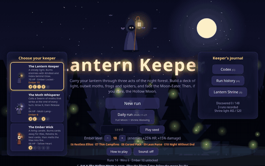
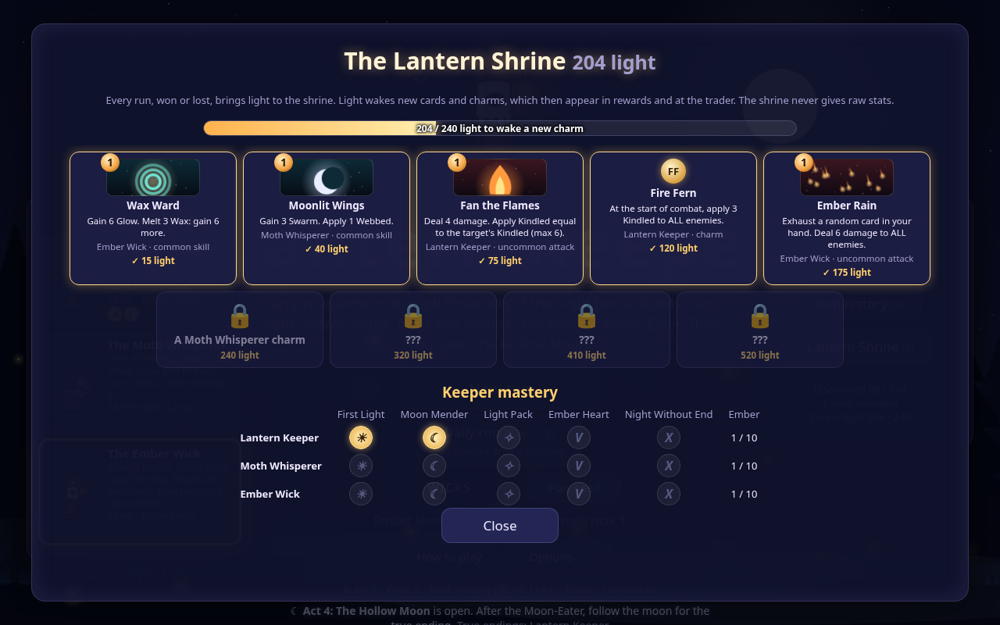
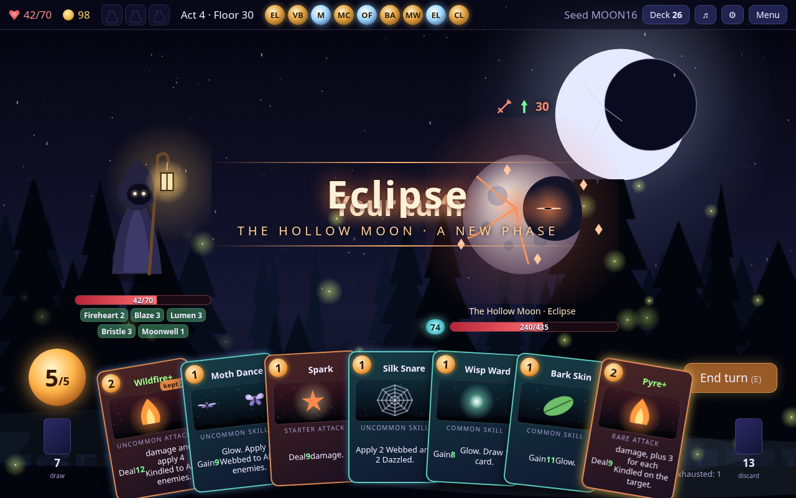

# Lantern Keeper

An original roguelite deckbuilder set in the night forest from Firefly Night and Mothlight. You are a small hooded keeper with a lantern. Climb three short acts on a branching map and fight moths, frogs, spiders, owls and bats with a deck of light. At the end, face the Moon-Eater. After your first win, a fourth act opens: the Hollow Moon, with a three-phase final boss and a true ending for each keeper.

Open `index.html` in any modern browser. It is a single file with no dependencies and works offline.

**Flagship:** this is Playbot's long-running project. The roadmap and checklist are in [PLAN.md](PLAN.md).

**v6, part 2 (2026-11-21):** a **smoother Ember ladder** (Ember 1–5 now add +2.5% enemy HP and +1.5% damage per level, and Night Without End is now just +10% boss HP), so every level from 0 to 10 is beatable and each one is a bit harder than the last. Enemy attacks now **fly a glowing bolt** at you, screens **fade** into each other, and the music adds a **heartbeat** when you are at 30% HP or less.

**v6, part 1 (2026-11-21):** **generative music and motion.** Every act now has its own live-generated soundtrack (no audio files): a pad, bass, plucked arpeggios and bells in a different mode and tempo per act, and a drum pulse during boss fights. A new **Options** screen (title button, the ⚙ button in the top bar, or `O`) has music and effects volume sliders and a **reduced-motion** switch (it follows the system setting at first). Bosses now get a **name card intro** with a flash, and phase changes get their own card. Cards are **dealt** into your hand each turn, and exhausted cards **burn away** upwards. Details below.

**v5 (2026-11-21):** **meta-progression and ascension depth.** **Ember 6–10** with named modifiers, unlocked per keeper. The **Lantern Shrine** unlock track: every run earns light, which wakes 6 new cards and 3 new charms into the pools. **Mastery badges** per keeper and **daily-run modifiers**. The Wick also gets an Act 4 boost. Details below.

**v4 (2026-11-21):** **Act 4: The Hollow Moon** and the **true ending**. Win once to open it. After the Moon-Eater you choose: rest at dawn (a normal victory) or follow the moon into a short 5-row act. It has 5 new creatures, 2 elites, 7 new events (some with keeper-only choices for Swarm, Wax and Kindled) and the three-phase final boss **The Hollow Moon**. Beating it shows an epilogue with art and text for each keeper. Details below.

**v3 (2026-11-21):** a third keeper, **The Ember Wick**, built around **Exhaust, Retain and Wax**. It has 18 class cards, 4 new charms, 4 new events and its own art. Details below.

**v2 (2026-11-21):** a second keeper (The Moth Whisperer, built around **Swarm**), **dew vials** (potions, 12 types, 3 slots), a **Codex** and a **Run History** screen, a lookahead sim bot and a re-balance. Details below.

## How it plays
- **Map:** each act has 7 rows of branching nodes and a boss. The node types are Fight, Elite (drops a charm), Campfire (heal 30% or upgrade a card), Moth Trader (cards, charms, card removal) and Mystery (text events). Every act has at least one trader and one elite.
- **Combat:** you get 3 energy and draw 5 cards each turn, with a draw pile, a discard pile and an exhaust pile. **Glow** is your shield and lasts until your next turn. Every enemy shows its **intent** (attack value with all modifiers applied, defend, buff, debuff or summon), so you can plan around it.
- **Statuses:** **Dazzled** means 25% less attack damage. **Webbed** means 50% more damage taken. **Kindled** burns N each turn, then drops by 1. **Damp** means 25% less Glow. **Blaze** adds attack damage, **Lumen** adds Glow, and **Bristle** hits back when you're attacked. There are also power effects: Lamp Oil, Firefly Cloud, Fireheart, Moonwell and Afterglow.
- **Content:** 41 cards plus 1 status card (3 starters, 16 commons, 15 uncommons, 7 rares, and Tangle, which spiders shuffle into your deck). There are 10 normal enemies, 3 elites (Moth Queen, Old Croaker, Night Heron) and 3 bosses (The Grand Weaver, which summons spiderlings and spins Tangles; The Bog King; The Moon-Eater). The game also has 14 charms (3 of them boss charms) and 7 events.
- **Rewards:** after each fight you pick 1 of 3 cards or skip (elites give better odds, bosses give rares). From act 2 on, some reward cards come already upgraded. A boss also lets you choose 1 of 3 charms. Between acts you heal 60% of your missing HP.
- **Seeds:** every run is deterministic. It uses 4 separate RNG streams (map, fight, loot, misc), so the map and events of a seed stay the same however you fight. You can type any seed on the title screen, and there is a **Daily run** (seed `daily-YYYY-MM-DD`) with its own best score per day.
- **Saving:** the run autosaves after every action (Continue on the title screen). Your best score, wins, runs, daily bests and mute setting are stored in localStorage.
- **Unlocks:** winning a run unlocks the next **Ember level**. Ember 1–5 are shared by all keepers and give enemies +2.5% HP and +1.5% damage per level (halved in v6). Ember 6–10 (v5) are unlocked per keeper and each adds a named modifier. Every run also brings light to the **Lantern Shrine**, which unlocks new cards and charms (see v5 below).
- **Input:** mouse, touch (tap a card, then tap an enemy; tapping the card again also works) and keyboard: `1`–`9`/`0` play a card, `←` `→` + `Enter` choose the target, `E` ends the turn, `D` opens the deck, `M` mutes, `O` opens Options, `Esc` cancels or goes to the menu, and arrow keys + `Enter` work on every menu. Tooltips explain every status, intent and charm.
- **Look and sound:** a canvas night forest with parallax trees, moon, stars, mist and fireflies, tinted per act. All 16 creatures and the keeper are drawn procedurally and animated (flapping moths, breathing frogs, wiggling spiders, a flickering lantern). Card art is generated per card. There are particles and popups for damage, Glow, burns and kills. The ~25 sound effects are synthesized with WebAudio and include an ambient cricket chirp, with mute.
- **Screen sizes:** a fixed 1280×800 stage scales to any window. Tested at 1280×800 and on tablet in both landscape (1180×820) and portrait (820×1180).

## v7 additions (part 2): first outlier tuning
- **Aurora** (rare) now gives +2 Blaze and +1 Lumen (was +2/+2; upgraded still +3/+3). It was top-3 for every keeper in the card report. Bot win rates at Ember 0 (600 runs, Lantern/Moth/Wick): 36.8/33.5/33.5% → 35.2/32.7/31.8%.
- **Tangle** in final decks comes only from the Mushroom Ring and Ash Grove events (intended trade-offs). Tangles from enemy web attacks stay in that combat.

## v7 additions (part 1): per-card sim report
- `node tools/sim.js 1000 --bots=heuristic --cards --quiet` writes `tools/card_report.txt`: per keeper and card, how often it was offered and picked at card rewards, its pick rate, and the win rate (beat the Moon-Eater) of runs whose final deck held it. `delta` is against the keeper baseline; `rel` is against the average reward-picked card, which removes the bias that long runs pick more cards. Marks: `++`/`--` (|rel| ≥ 10 pp), `+`/`-` (≥ 5 pp), `!pick` (pick rate ≥ 60%), `?pick` (≤ 10%). The first findings are in PLAN.md (Aurora is strong for every keeper, the bot over-picks Wildfire, and it under-picks Swarm, Wing Wall and Flicker).

## v6 additions (part 2): Ember ladder and more motion
- **Ember retune.** Before, the sim bot went from 35–40% at Ember 0 to 1–4% at Ember 5 and about 0% at Ember 6–10, so the top half of the ladder could not be tuned. Ember 1–5 scaling is halved (now in `TUNE.emHp` / `TUNE.emDmg`), and Night Without End (E10) dropped its 2 Blaze and went from +15% to +10% boss HP (`TUNE.nightHp`, `TUNE.nightBlaze`). New bot win rates (300 runs each, Acts 1–3, Lantern / Moth / Wick):

| Ember | 0 | 1 | 2 | 3 | 4 | 5 | 6 | 7 | 8 | 9 | 10 |
|---|---|---|---|---|---|---|---|---|---|---|---|
| Lantern | 38.3 | 29.0 | 23.3 | 19.3 | 13.3 | 9.0 | 8.3 | 8.0 | 5.0 | 2.7 | 1.3 |
| Moth | 32.0 | 27.3 | 23.7 | 20.0 | 11.3 | 8.7 | 8.7 | 7.0 | 7.7 | 7.7 | 4.0 |
| Wick | 34.3 | 26.7 | 22.7 | 19.0 | 14.7 | 12.7 | 9.3 | 8.3 | 6.0 | 5.3 | 3.0 |

  A human who knows the cards should do clearly better than this bot. Lean Purse (E9) hurts the Lantern most.
- **Enemy bolts:** every attacking move sends 1–3 glowing bolts (one per hit, colour per creature) from the enemy to the keeper.
- **Screen fades** between title, map and combat.
- **Signature attacks:** spiders and the Grand Weaver shoot sticky web strands, frogs, the Old Croaker and the Bog King lash out with a tongue, and the Moon-Eater and the Hollow Moon throw big silver moonlight orbs.
- **Lean Purse (E9)** now takes 25 starting gold instead of 40 (bot at E9: Lantern 2.7 → 4.0%, Moth 5.3%, Wick 5.7%; E10: 1.7 / 3.0 / 3.7%).
- **New GIF** (`tools/record-gif.js`): title, Options, then the Grand Weaver's intro card and a fight with web strands and dealt hands.
- **Heartbeat:** at 30% HP or less, a soft double kick joins the act music (boss music already has a pulse).
- **Shop and rewards:** the trader shows your gold, items you can't afford are greyed out, the layout is more compact (Leave no longer overlaps the vials), and reward cards slide in one after another.
- All of these respect reduced motion. v6 is complete.

## v7 accessibility (part 3)
- **Text size** in Options (Normal / Large / Larger, saved): enlarges tooltips, event text, panel text, intents and card text; at the larger sizes the card art shrinks so the text still fits inside the fixed 1280x800 stage.
- **Colour-blind-safe intents:** every intent kind has its own shape, not just a colour: attack = sword, block = ring, debuff = diamond with a down chevron, buff = up arrow, summon = twin circles with a +. Intents and cards have aria-labels for screen readers.
- Verified with `node tools/v6-check.js` (text size cycles, applies and survives a reload). Screenshot: `screenshot-options.png`.

## v6 additions (part 1): music, options and motion
- **Generative music** (`src/audio.js`, `MOODS`): a small step sequencer on the WebAudio clock with 6 moods. Title: D major pentatonic, 64 bpm. Act 1: D dorian, 72 bpm. Act 2: A aeolian with a darker sawtooth pad, 66 bpm. Act 3: E phrygian, 60 bpm. Act 4: C lydian with more bells, 54 bpm. Boss fights: G phrygian-ish at 92 bpm with a kick pulse. Each mood plays a 4-chord loop (2 bars per chord) with pad, bass, random plucks and bells, so it never repeats exactly. Moods crossfade over about 2 seconds. Music only starts after your first tap (needed on iOS), and Mute stops it too.
- **Options screen:** Sound on/off, Music volume, Effects volume and Motion (full or reduced). All of it is saved.
- **Reduced motion:** no shaking or lunging, no flash, no card flights or burn-aways, no deal animation, and a fifth of the particles. It starts on if your system asks for reduced motion.
- **Boss intro:** a big name card with the act name, a flash and the boss sound. Hollow Moon phase changes show the phase name the same way.
- **Card animations:** the hand is dealt in with a short stagger at the start of each turn. Exhausted cards float up and burn away.
- **Verified:** `node tools/v6-check.js` (options open, volume and motion saved and applied across a reload, title → act 1 → boss music moods, boss name card) plus the full test suite. Screenshots: `screenshot-options.png` and `screenshot-boss-intro.png`.

## v5 additions: meta-progression and ascension depth

- **Ember 6–10, per keeper.** Ember 1–5 work as before: they are shared by all keepers, and each level gives enemies +2.5% HP and +1.5% damage (v6; it was +5%/+3%). From Ember 6 on, stat scaling stops. Each level adds one **named modifier** instead, and the modifiers stack. Win at Ember N with a keeper to open Ember N+1 for **that keeper** (Ember 5 → 6 → … → 10). Daily runs don't climb the ladder.
  - **E6 Restless Elites:** elites start every combat with 2 Blaze.
  - **E7 Thin Campfires:** resting heals 20% of max HP instead of 30%.
  - **E8 Cursed Pack:** you start with **Gloom**, a new curse card. It costs 1, does nothing, and can only be removed at a trader.
  - **E9 Lean Purse:** you start with 25 less gold (v6; it was 40) and earn 30% less gold from combat.
  - **E10 Night Without End:** bosses have 10% more HP (v6; it was 15% and 2 Blaze).
  - The title screen lists the active modifiers under the Ember picker (each has a tooltip), keeper cards show their own Ember cap, and the map side panel lists the run's modifiers.
- **The Lantern Shrine** (title → *Lantern Shrine*, or `S`). Every finished run brings **light**: 1 per floor, +5 per elite, +10 per boss, +20 for a win, +25 for the true ending and +2 per Ember level. Light wakes **9 shrine gifts**. Once awake, a gift joins the reward, trader and charm pools. The shrine never gives raw stats. Locked gifts never drop (tested over 36 full runs).
  - 15 light: **Wax Ward** (Wick, common): 6 Glow; melt 3 Wax for 6 more.
  - 40 light: **Moonlit Wings** (Moth, common): +3 Swarm, apply 1 Webbed.
  - 75 light: **Fan the Flames** (Lantern, uncommon): 4 damage; the target's Kindled doubles (up to +6).
  - 120 light: **Fire Fern** (Lantern charm): enemies start every combat with 3 Kindled.
  - 175 light: **Ember Rain** (Wick, uncommon): exhaust a random card in hand, 6 damage to ALL enemies.
  - 240 light: **Silk Cocoon** (Moth charm): with 8+ Swarm at the end of your turn, gain 5 Glow.
  - 320 light: **Night Flight** (Moth, uncommon): 4 damage to ALL enemies, +1 Swarm per enemy hit.
  - 410 light: **Beacon** (Lantern, rare power): whenever a card gives you Glow, deal 2 damage to a random enemy.
  - 520 light: **Wax Signet** (Wick charm): +1 Wax for each card you Retain.
  - All 6 cards have new or reused procedural art (new motifs: a lighthouse for Beacon, falling embers for Ember Rain, a curse sigil for Gloom). Shrine charms get a gold badge.
  - The screen shows a progress bar, every gift (awake ones in full, the next one as a hint, later ones as ???) and the keeper mastery table. The Codex Journey tab and the title journal show the shrine's progress.
- **Mastery badges per keeper:** First Light (win), Moon Mender (true ending), Light Pack (win with ≤15 cards), Ember Heart (win at Ember 5+) and Night Without End (win at Ember 10). They appear on the keeper cards on the title screen, in the Shrine's mastery table and in the Codex Journey tab. The end screen announces new badges, new shrine gifts, light earned and new Ember levels.
- **Daily-run modifiers:** each day gets 1–2 named modifiers. They are picked from a hash of the date, never from the run's RNG streams, so everyone plays the same daily. They show on the Daily button (with a tooltip) and on the map side panel. The modifiers: **Full Moon** (every fight drops a vial), **Gilded Night** (+50% gold), **Shrine Blessing** (every shrine gift is in the pools), **Glass Lantern** (−15% max HP, 4-card rewards), **Starlit Gift** (start with a random rare card), **Kindled Night** (enemies start with 3 Kindled) and **Restless Night** (enemies +10% HP). Without Shrine Blessing, daily runs use the base pools, so they stay comparable.
- **Wick Act 4 boost:** the Tallow Heart gives 5 Wax at the start of combat in Act 4 (2 elsewhere). All steals take only half as much Wax, rounded up (Swarm steals are unchanged). The Wick's true-ending conversion went from 52% to 60% (shrine gifts off).
- **Save migration:** run saves move from v4 to v5. The meta save is upgraded once. Light is estimated from the 20-run history (floor, wins, true endings, Ember), plus 8 per older run and 40 per older win. Badges and per-keeper Ember wins are rebuilt from history and the true-ending counts.
- **Balance** (lookahead bot, 600 runs per keeper; Act 3 cleared / true ending):
  - Ember 0, shrine gifts off (identical to v4): Lantern 40.3 / 26.5%, Moth 38.3 / 22.8%, Wick 34.3 / 20.5%.
  - Ember 0, every shrine gift unlocked: Lantern **36.8%**, Moth **33.5%**, Wick **33.5%**, all inside the 30–40% target. The new cards don't break anything; the bot just spreads its picks across more cards.
  - Ember 10: Lantern 0.0%, Moth 0.0%, Wick 0.2%. The bot already fell to 1–4% at Ember 5, so Ember 6–10 are aimed at strong human players.
- **Verified:**
  - `node tools/test.js` passes **46 groups** (6 new):
    - Every Ember 6–10 modifier, with stats frozen after Ember 5, E10 determinism and Gloom behaviour.
    - The per-keeper Ember ladder and its migration.
    - Shrine pools: locked gifts never drop and unlocked ones do; light thresholds and the light formula.
    - Every shrine card and charm working as written, plus v4 → v5 run migration.
    - Badges (per keeper, never twice, rebuilt from history, idempotent migration).
    - Daily modifiers: 120 dates, each modifier's effect, and determinism.
  - `node tools/browser-test.js`, 0 console errors:
    - Opens the Shrine by click: 5 of 9 gifts awake after the test's wins, badges on the title and in the table.
    - Selects Ember 10 with 5 named modifiers, and checks that the Moth Whisperer is capped at 5.
    - Starts seed EMBERTEN at Ember 10 (Gloom in the deck, 59 gold, modifiers on the map) and plays its first fight by clicks.
  - `node tools/sim.js 600 --bots=heuristic [--shrine=all|none] [--ember=N]`: the new `--shrine` flag defaults to `all`.
  - `node tools/shots-v5.js` makes the showcase screenshots from a demo save.
- Screenshots: screenshot-shrine.png, screenshot-ember10.png. lantern-keeper.gif was re-recorded and now shows the title with badges, the Shrine, and a Hollow Moon fight entering its Eclipse phase.

## v4 additions: Act 4, The Hollow Moon

- **Unlock and flow:** the first win with any keeper opens Act 4 (old saves with a win unlock it automatically). The title screen shows a line for it (and lists your true endings), and the Codex has a new **Journey** tab with all 4 acts, their bosses and your true endings per keeper. Once it's open, beating the Moon-Eater leads to a **crossroad**:
  - **Follow the moon:** take the usual boss reward and boss charm, heal 60% of missing HP, and climb Act 4.
  - **Rest at dawn:** the run ends as a normal victory.
- **Act 4 map:** 5 rows instead of 7. It always has a trader, an elite, at least one Mystery and a campfire row before the boss. Act 4 events only appear in Act 4, and Acts 1–3 never show them (tested). The background has a huge cracked moon with silver motes falling from it.
- **The Hollow Moon** (final boss, 300 base HP, about 435 after Act 4 scaling) has **3 phases**. Each phase changes its art, its name tag and its move pattern, and its intent switches at once when you cross a threshold:
  - **Waning** (100–60%): Pale Gaze (10 damage plus Dazzled and Damp), Silver Tide (7×3), and Wane (20 Glow, shuffles 2 Moonchill into your discard).
  - **Eclipse** (at 60%): the moon cracks open with a burning core. It **sheds all burns and debuffs** (bad news for stacked Kindled) and gains 30 Glow. Moves: Eclipse (12 Glow, **steals up to 5 Swarm and Wax**, Dazzled), Devour Light (20 damage, heal 10) and Moon Shards (5×4).
  - **New Moon** (at 25%): it goes dark violet, sheds its burns again, and gains 20 Glow and 2 Blaze. Moves: Moonfall (16 damage, +3 Blaze each time) and Gather the Dark (15 Glow, summons a Pale Moth).
  - One huge hit can skip straight through both thresholds.
- **5 new creatures** (all drawn procedurally):
  - **Pale Moth:** Glimmer, Moonsip (steals 2 Swarm/Wax), Nibble ×2.
  - **Hollow Hare:** fixed Thump → Leap ×2 → Leap ×2 rhythm.
  - **Moonsnail:** Withdraw (16 Glow, sheds its debuffs) → Silver Spit (Damp) → Cold Ooze (adds Moonchill).
  - **Glass Spider:** opens with Glass Web (Moonchill plus Webbed), then Glass Fang and Mirror Shell.
  - **Moon Wisp:** Flicker ×2, Fade (Glow plus heal) and Hush (Damp plus Dazzled).
- **2 new elites:** **The Silver Stag** (Bellow sheds its debuffs, Moon Charge for 26, Antler Sweep) and the **Leech Mother** (Deep Sip steals 4 Swarm/Wax, Brood summons Pale Moths, Drain for 14 and heal 14).
- **New status card: Moonchill.** It costs 0: lose 2 HP, then exhaust it. Left in hand it clogs your draws. The Ember Wick's random exhaust eats it first.
- **New enemy move types:** steal (Swarm and Wax), cleanse (shed debuffs), a configurable status card to shuffle in, and boss phases. They all show up in the intent tooltips.
- **7 new events (Act 4 only).** Keeper-only options are shown to everyone with a "[Keeper only]" tag but can only be picked by that keeper. **Moon blessings** last for the rest of the run (shown as a ☾ charm in the top bar):
  - **The Silver Hive:** Moth only, +3 Swarm at the start of every combat; or moon honey (heal plus max HP); or smoke them out for gold.
  - **Pool of Moonwax:** Wick only, +4 Wax at the start of every combat; or bottle a dew vial; or upgrade 2 random cards for 6 HP.
  - **The Cold Hearth:** Lantern only, enemies start every combat with 3 Kindled; or remove a card; or heal.
  - **The Three Sconces:** light your own sconce, a blessing that depends on your keeper (Lantern +2 Kindled on enemies, Moth +2 Swarm, Wick +3 Wax); or light all three (−8 max HP, upgrade 3 cards); or take 40 gold.
  - **The Moon Mirror:** copy a card of your choice (new "copy" pick mode); or 80 gold and 2 Moonchill; or look away.
  - **A Fallen Star:** a rare card for 10 HP, or heal 20.
  - **Echo of the Stag:** fight the Silver Stag as an elite from inside the event, or bow and heal.
- **True ending:** beating the Hollow Moon shows an **epilogue screen for each keeper**, with its own text and dawn art:
  - The Lantern Keeper fills the moon with light and the old beacons relight.
  - The Moth Whisperer's swarm becomes the moon's new shell.
  - The Ember Wick melts into the crack, and a new little candle-spirit lights itself from the last drop.
- **Scoring and history:** a true ending scores **+400** on top of the victory bonus, and floors keep counting through Act 4. Run history shows "☾ True ending", the end screen shows "Acts cleared N / 4", and the title lists which keepers have a true ending.
- Totals: 82 cards (plus Moonchill), 24 creatures (5 elites, 4 bosses), 20 charms, 18 events and 12 dew vials.
- Screenshots: screenshot-act4-map.png, screenshot-final-boss.png (Eclipse phase), screenshot-epilogue.png and screenshot-crossroad.png.

## v3 additions: The Ember Wick
- **The Ember Wick** is a living candle (68 HP). Its starting charm is the **Tallow Heart**: start each combat with 2 Wax, gain 1 Wax whenever a card is exhausted, and heal 4 HP after each combat. Starter deck: 4 Singe, 4 Glow Shield, 1 Melt Down (Glow, exhaust a random other card, draw 1) and 1 Candle Flare.
- **Unlock:** reach Act 3 with any keeper (or win a run). Until then, the title screen shows a lock with that hint. Older saves unlock it automatically if the run history already has an Act 3 run or a win.
- **New mechanics:**
  - **Exhaust triggers.** Cards and powers react whenever any card is exhausted, including Tangles you play.
  - **Retain.** A Retain card stays in your hand at the end of the turn. A small badge shows "retain", or "kept N" after N turns. Some cards grow while held.
  - **Wax.** A combat resource (max 30). Some cards **Melt** Wax for extra effects. The keeper's art shows one rising ember per Wax.
  - "Exhaust a random other card" always takes Tangles first and attacks last, so you don't burn away your only damage.
- **18 class cards** (marked ✸):
  - Commons: Candle Flare, Wax Seal (Retain), Snuff Out, Wax Drip, Slow Burn (Retain, +3 per turn held), Tallow Guard, Flicker (Retain, 0 cost).
  - Uncommons: Cinder Halo (power: damage when a card is exhausted), Waxwork (power: Glow when a card is exhausted), Consume (exhaust your hand, 7 damage per card), Molten Wave (melt all Wax, AoE), Patient Flame (Retain, energy that grows), Rekindle (return a card from the exhaust pile), Wax Effigy (melt all Wax into Glow).
  - Rares: Eternal Flame (Retain your whole hand), Feed the Flame (draw when a card is exhausted, at most 4 per turn), Bonfire (AoE scaling with your exhaust pile), Candlemass (Retain, double your Wax).
- **New charms:**
  - Tallow Heart (Ember Wick starting charm).
  - Beeswax Candle (start each combat with 4 Wax; Wick only).
  - Brass Snuffer (the first exhaust each turn draws a card).
  - Cupped Leaf (at the end of your turn, Retain your most expensive card).
  - Wick-only charms are never offered to the other keepers (tested).
- **New events:**
  - The Candlemaker's Hut: melt a card into a random uncommon, or buy a candle that becomes a dew vial.
  - Wishing Flame: burn 2 starter cards for 5 HP, or heal.
  - The Ash Grove: gold plus a Tangle, or upgrade a card for 8 HP.
  - A Lost Little Flame: carry it home for the Cupped Leaf.
- New card motifs (candle, wax drips, wax seal, snuffer, ember halo), keeper art (a wax head with drips, a flickering flame and a brass snuffer bell) and event art. The Codex picks up every new card and charm automatically.
- The game now has 81 cards (25 shared, 16 Lantern, 19 Moth, 20 Wick including starters), 20 charms, 11 events and 12 dew vials.

## v2 additions
- **Two keepers** (picked on the title screen, choice remembered):
  - **The Lantern Keeper** (70 HP, Ember Locket: heal 6 after each fight). Starter deck: 5 Spark, 4 Glow Shield, 1 Lantern Swing. Kindled, Glow and power builds.
  - **The Moth Whisperer** (64 HP, Moth Lamp: start each fight with 3 Swarm, heal 3 after each fight). Starter deck: 5 Wing Flick, 4 Glow Shield, 1 Call the Moths. It is locked (a lock marker on the title) until you win your first run.
  - **Swarm** is the Moth Whisperer's mechanic. At the end of your turn, your moths deal damage equal to your Swarm to a random enemy (max 20). The moths orbit the keeper on screen, one per stack. Its **17 class cards** plus 2 starters: Flutter, Nibbling Moths, Dust Veil, Pollen Cloud, Moth Bites, Wing Wall, Release the Swarm (3 damage per Swarm, then lose it all), Brood Mother, Cocoon, Feeding Frenzy, Moon Lure, Split the Swarm, Moth Storm, Dusk Shroud, Night Queen (Swarm hits ALL enemies), Thousand Wings and Devour.
  - Card pools are split: 25 shared cards, 16 Lantern-only cards and 19 Moth-only cards. Each keeper only ever sees its own cards plus the shared ones (tested). Moth cards are marked ✦.
- **Dew vials** (potions): you have 3 slots in the top bar, and using a vial in combat costs no energy. There are 12 vials: Firefly Draught (20 damage), Glow Tonic, Healing Dew (25% HP), Moon Nectar (+2 energy), Swift Dew (draw 3), Silk Flask, Flash Powder, Ember Brew, Lamp Oil Flask, Moth Jar (+6 Swarm), Clear Dew (cleanse) and Bottled Starlight (12 to all).
  - Where they come from: fights drop one 40% of the time, elites 60% and bosses always. If your belt is full, the drop is lost. The Moth Trader sells 3 vials (42–84 g). A new charm, the Vial Belt, makes every fight drop a vial.
  - How to use them: in combat, click a vial (then an enemy for targeted ones) or press Z / X / C. Outside combat, click a vial twice to toss it.
- **Codex** (title screen, `C`): every card, charm, vial and creature you have seen, shown with art and text. Undiscovered entries appear as ???. **Run History** (`H`) lists your last 20 finished runs: date, keeper, seed, Ember, result (and killer), floor and score. Both are kept in localStorage. v1 saves are migrated automatically.

## Code
- `src/engine.js` is the pure rules engine: plain-data state (JSON-serializable), `newRun / legal / act`, the content tables and two bots. It runs in node and the browser.
- `src/ui.js`, `src/art.js`, `src/audio.js`, `src/style.css` and `src/template.html` are the UI. `node tools/build.js` inlines everything into `index.html`.
- `tools/sim.js` is the balancing sim (`--keeper=lantern|moth|wick|all`, `--cards` for the per-card report, `--hpW=` for the Wick HP offset, `--act4=0|1` to lock or open Act 4, and `--act4m=` for the Act 4 multiplier). `tools/test.js` holds the rules tests, and `tools/browser-test.js` runs a headless Chrome playthrough. `tools/record-gif.js` records lantern-keeper.gif.

## Balancing (tools/sim.js, outputs in tools/sim_results.txt)
- **v4 (Act 4 open, lookahead bot, 600 runs per keeper, Ember 0).** "Act 3" is the share of runs that beat the Moon-Eater. The bot always follows the moon. `--act4=0` gives the old 3-act numbers, which are unchanged:

| Keeper | Beat Act 3 | True ending (Act 4) | Act 4 clear rate of Act 3 winners |
|---|---|---|---|
| Lantern Keeper | **40.3%** | **26.5%** | 66% |
| Moth Whisperer | **38.3%** | **22.8%** | 60% |
| Ember Wick | **34.3%** | **17.8%** | 52% |

  - Act 4 enemies use `TUNE.act4 = 1.45` (HP and damage). At ×1.0 every Act 3 winner also finished Act 4, so it wasn't a challenge. At ×1.7 only 22–29% did.
  - The Hollow Moon is the main Act 4 killer. The Wick suffers most from Wax theft, so steals were trimmed (Pale Moth 3→2, Leech Mother 5→4, Eclipse 8→5), and New Moon now also sheds burns, which evens out the Lantern Keeper.
  - There is 1 stall in 1,800 runs: a Wick deck that exhausted itself down to Glow cards against the boss. The 80-turn cap counts it as a loss.

- The **heuristic bot (v2)** plans whole turns ahead. It runs a beam-limited depth-first search over play sequences: up to 160 states per decision, the top 4 moves at the root, then 3, then 2, with duplicate cards collapsed. It scores the state where the turn would end: enemy HP, unblocked incoming damage (lethal is heavily penalized), statuses, powers and Swarm. Vials are worth 7 to 34 points while unused (cheap to drink in boss fights, expensive in normal fights), so it saves them for moments that matter. Outside combat it uses simple rules for paths, card picks, rest, shop (it buys vials with spare gold) and events.
- `greedy` is the old v1 one-step bot, kept for comparison. The **random bot** picks uniformly from the legal actions (cards and vials) and ends its turn 15% of the time.
- `node tools/sim.js 600 --bots=heuristic,greedy,random` spreads the runs over 8 worker processes. Ember 0 results, 600 runs per bot:

| Keeper | Lookahead (v3) | Old greedy | Random |
|---|---|---|---|
| Lantern Keeper | **40.3%** | 5.3% | 0.0% |
| Moth Whisperer | **38.3%** | 6.7% | 0.0% |
| Ember Wick | **34.3%** | 2.2% | 0.0% |

- v3 Ember ladder (lookahead, 300 runs each), Lantern / Moth / Wick: E1 28.0 / 27.3 / 23.3%, E2 17.7 / 14.3 / 16.3%, E3 9.0 / 8.7 / 11.0%, E4 4.0 / 4.3 / 6.7%, E5 1.3 / 1.0 / 4.3%.
- How the Ember Wick was tuned: the first draft won 10.3%. It burned away its own attacks and stalled with no damage left. The fixes:
  - Random exhaust now takes attacks last, and the bot is penalized for exhausted attacks.
  - Melt Down draws a card.
  - Candle Flare joined the starter deck.
  - The Tallow Heart starts fights with 2 Wax.
  - HP went to 68, and Snuff Out, Consume and Cinder Halo got small buffs.
  - Result: 19% → 26% → 35% (34.3% over 600 runs). The Wick dies mostly to the Grand Weaver and the Bog King. The Moth Whisperer went from 34.8% to 38.3%, because the new shared charms and events help it.
- v2 numbers, for history: Lantern 39.8%, Moth 34.8%.

- The Lantern Keeper mostly dies in act 1 (to the Grand Weaver). The Moth Whisperer gets through act 1 easily but falls to the Bog King and the Moon-Eater. There are no stalls.
- Ember ladder (lookahead bot, 300 runs each), Lantern / Moth: E1 26.3% / 23.7%, E2 15.7% / 14.7%, E3 8.3% / 8.3%, E4 3.0% / 3.7%, E5 2.7% / 3.3%.
- Tuning: the new bot is much stronger, so `E.TUNE` went from enemy HP ×0.9 / damage ×0.9 to HP ×1.0 / damage ×1.02. Act 1 stays ×1.1 and act 3 ×0.97. Vials drop from 40% of fights, and per-keeper HP offsets live in `TUNE.hp`.

## Verified (v4)
- `node tools/test.js` passes **40 groups** (output in tools/test_output.txt). The existing groups now also cover 4 acts of map structure, every enemy's moves including each boss phase, and every event option (keeper-only options are run with their keeper). The 8 new groups:
  - **v4 content:** 5 creatures, 2 elites, a 3-phase boss with 3 art variants, 7 Act 4 events, Swarm/Wax/Kindled options, an epilogue per keeper, and art for every creature, phase and event.
  - **Every new creature and elite uses every move**, and steal, cleanse and Moonchill do what their intents say. Moonchill costs 2 HP and exhausts.
  - **Boss phases:** the 60% and 25% thresholds, the art, intent and pattern switch, Eclipse shedding Kindled and Webbed and stealing Wax/Swarm, New Moon gaining Blaze, a big hit skipping both thresholds, and the kill being the true ending.
  - **Every option of each Act 4 event for each keeper** (51 options): keeper-only legality, labels, picks (copy), the echo fight, and blessings applied at the start of the next combat.
  - **Act 4 map structure** over 300 seeds (5 rows, shop, elite, event, a campfire row, Act 4 enemies only), and Act 4 events only in Act 4.
  - **Unlock and climb:** the unlock rule, keeper unlocks unchanged, the locked run ending at the Moon-Eater, the crossroad (dawn = victory, moon = boss reward, boss charm, Act 4), and the true-ending score.
  - **Save/load mid-Act 4:** a bot run reaches an Act 4 fight, does a JSON round trip, and continues identically; v3 saves migrate.
  - **Bots in Act 4:** 45 lookahead runs (every action legal, true endings reached) and 150 random-bot Act 4 runs.
- `node tools/browser-test.js` (0 console errors) runs every v3 check, then:
  - Checks that the title shows Act 4 open after the LANTERN win and that the Codex **Journey** tab lists Act 4.
  - Fast-forwards seed **MOON16** to the Moon-Eater crossroad by engine (debug seeding), saves it, and clicks **Continue** on the title.
  - Plays the rest **by real clicks**: Follow the moon, boss reward, charm, the whole Act 4 map and the Hollow Moon. On screen, the boss art goes through all 3 phases (hollowmoon → hollowmoon2 → hollowmoon3).
  - Reaches the **epilogue** (canvas shown, Lantern text), with the true-ending count, a history row "True ending" and the title listing it.

## Verified (v3)
- `node tools/test.js` passes **32 groups** (output in tools/test_output.txt). The 22 v2 groups loop over every keeper, so the Wick is also covered by determinism, save/load, pool separation, the 300-run fuzz and the lookahead-beats-greedy check. The 10 new groups:
  - v3 content counts, plus a card-art motif for every card.
  - Retain (held counter, Slow Burn and Patient Flame growth, the counter resets when played).
  - Eternal Flame and Cupped Leaf.
  - Every exhaust trigger (Tallow Heart Wax, Cinder Halo, Waxwork, Feed the Flame's cap of 4 per turn, Brass Snuffer once per turn, Tangles).
  - Random-exhaust priority, plus Consume, Rekindle and Bonfire scaling.
  - Wax (Melt costs, Molten Wave, Effigy, Candlemass, Tallow Guard, the cap of 30, Beeswax).
  - **Every Ember Wick card base and upgraded** (40 plays, and every upgrade is never worse).
  - The unlock rules (including a real bot run that dies in act 3).
  - Wick-only charms never reaching other keepers, plus every option of the 4 new events for every keeper (27 options).
  - Save/load mid-combat with retained cards, Wax and powers, and migration of v2 saves.
- `node tools/browser-test.js` checks 0 console errors. Three keepers appear, with the Moth Whisperer and the Ember Wick locked (with the Act 3 hint). A full winning run of seed **LANTERN** is played by real clicks, and the win unlocks both. Everything from v2 still passes. Then the test **picks the Ember Wick** by click and starts seed WICKS (its own deck and charm). It injects a Wax Seal, ends the turn by click, and checks that the card is still in hand with a "kept 1" badge before playing it by click. Then it plays 3 fights with real clicks.
- Screenshots added in v3: screenshot-title-keepers.png (three keepers), screenshot-wick-combat.png and screenshot-wick-reward.png. lantern-keeper.gif was re-recorded with the Ember Wick.

## Verified (v2)
- `node tools/test.js` passes **22 groups** (output in tools/test_output.txt). The 11 v1 groups still pass, and the "every card is playable" group now covers all 61 cards (244 plays).
- The 11 new groups cover:
  - v2 content counts, plus each keeper's starting deck, charm and HP.
  - Card pool separation over 80 full runs.
  - **Every dew vial** used on every target with each keeper, checking its effect, that the slot empties, that it costs no energy and that it is counted.
  - Vial belt rules: no buying when full, toss, buying into a free slot, no drinking outside combat, a drop lost to a full belt, and a drop rate of 236 vials in 422 won fights.
  - **Swarm** mechanics: Moth Lamp, end-of-turn damage, the cap of 20, Release, Brood, Frenzy and Night Queen.
  - **Determinism** for both keepers with Ember and vials.
  - **Save/load** mid-combat with vials and the keeper, plus migration of v1 saves.
  - A fuzz of 300 random-bot runs per keeper with vials (36k actions, all legal).
  - The lookahead bot only plays legal moves and beats the old greedy bot for both keepers.
  - The score formula.
- `node tools/browser-test.js` checks 0 console errors (output in tools/browser_test_output.txt). Step by step:
  - At first the Moth Whisperer is locked and can't be picked.
  - A **full winning run of seed KEEPER** with real clicks: 15 fights, 190 card clicks, **7 vial clicks**, 1 vial bought at the trader.
  - The win unlocks Ember 1 and the Moth Whisperer, and a history entry is written.
  - Reload + Continue, a keyboard-only fight, then **Codex** (all 4 tabs list discovered entries) and **Run History** (opened with H, lists the KEEPER win).
  - **Picking the Moth Whisperer** by click and starting the seeded run MOTHS (its own deck, Moth Lamp, 3 Swarm at the start of combat).
  - A **Firefly Draught drunk by mouse** on a chosen target and a **Moth Jar drunk with the C key** (+6 Swarm), then the fight finished by clicks.
  - The tablet touch run.
- Fixed along the way:
  - In a new fight, an enemy element left over from an earlier fight with the same uid could keep its old art. For example, a Dusk Moth drawn as a frog.
  - The UI accepted clicks during the 0.7 s transition after an enemy turn ended a fight.
- Screenshots: title, title-keepers, map, combat, moth-combat, moth-reward, reward, event, rest, shop (with vials), codex, codex-cards, history, victory, tablet and tablet-portrait. (lantern-keeper.gif was re-recorded in v5: title with badges, the Shrine, and a Hollow Moon fight entering Eclipse.)
