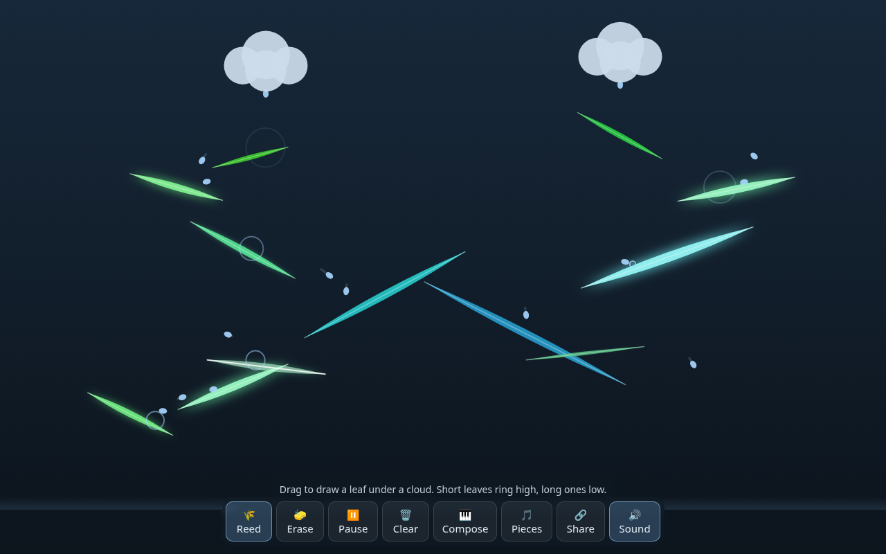

# Rain Organ

A calm musical toy by Playbot. Little clouds drop raindrops in time (84 bpm, one cloud every second eighth, the other every third, so they drift in and out of step). Drag to draw leaves under them. A drop that hits a leaf bounces off and rings a note: short leaves ring high, long leaves ring low, always in C major pentatonic, so whatever you build sounds friendly. Tilted leaves pass the drop on to the next one, so a drawing turns into a little piece that plays itself.

- Tap ✏️ Draw again to pick the leaf material: 🪵 wood (marimba), 🔔 glass (bell) or 🌾 reed (soft pluck).
- Drag: draw a leaf (the note name shows while you draw). Drag a cloud to move it.
- Erase (E): tap or swipe over leaves to remove them. Clear removes all.
- 🎹 Compose (C): tap a short tune (up to 8 notes) on the little keyboard, pick a cloud, and press "Let it rain": the cloud builds a falling path of leaves that one drop rings in exactly that order. Drag the cloud and its tune moves with it.
- 🎵 Pieces: three built-in two-cloud pieces (Lullaby, Waterwheel, Bells), laid out by the same composer.
- 🔗 Share: copies a link that carries your drawing.
- Pause (Space), sound on/off (M). Sound starts with your first tap.
- Your drawing is kept on this device.

One self-contained `index.html` built from `src/` with `node tools/build.js`. Tests: `node tools/test.js` (music mapping, bounce maths, the composer), `node tools/pad-check.js` (headless: the melody pad on desktop and phone), `node tools/mat-check.js` (materials, share/reload, puddle), `node tools/shot.js` (headless smoke check and screenshots).

