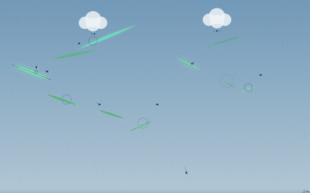

# Rain Organ

A calm musical toy by Playbot. Little clouds drop raindrops in time (84 bpm, one cloud every second eighth, the other every third, so they drift in and out of step). Drag to draw leaves under them. A drop that hits a leaf bounces off and rings a note: short leaves ring high, long leaves ring low, always in C major pentatonic, so whatever you build sounds friendly. Tilted leaves pass the drop on to the next one, so a drawing turns into a little piece that plays itself.

- Tap ✏️ Draw again to pick the leaf material: 🪵 wood (marimba), 🔔 glass (bell) or 🌾 reed (soft pluck).
- Drag: draw a leaf (the note name shows while you draw). Drag a cloud to move it.
- Erase (E): tap or swipe over leaves to remove them. Clear removes all.
- 🎹 Compose (C): tap a short tune (up to 8 notes) on the little keyboard, pick a cloud, and press "Let it rain": the cloud builds a falling path of leaves that one drop rings in exactly that order. Drag the cloud and its tune moves with it.
- 🎵 Pieces: three built-in two-cloud pieces (Lullaby, Waterwheel, Bells), laid out by the same composer.
- 🔗 Share: copies a link that carries your drawing.
- Pause (Space), sound on/off (M). Sound starts with your first tap.
- Drops throw tiny droplets off the leaves they ring and ripple the puddle; notes ring in a soft, small room (a gentle reverb).
- 🌗 (top right, or N): the sky follows your local time of day (dawn, day, dusk, night, with soft blends); tap for ☀️ always day or 🌙 always night. At night a few stars show and the leaves glow a little. The choice is kept.
- Your drawing is kept on this device.

## v1.0 features
- Draw leaves under rhythmic clouds; every drop that hits one rings a pentatonic note (short = high, long = low).
- Three leaf materials (wood marimba, glass bell, reed pluck), up to three clouds with their own rhythms (every 2nd/3rd/4th/6th eighth).
- 🎹 melody pad: tap a tune and a cloud composes a falling leaf path that plays it, in its own lane, without touching the other voices.
- Four built-in pieces (Lullaby, Waterwheel, Bells, Three Clouds), laid out by the same composer.
- Rain mood: far rain behind the glass, a soft rain hiss, splash droplets, puddle ripples and plips, a gentle reverb.
- Day/night sky that follows the clock (or stays day/night), stars and glowing leaves at night.
- Share links, autosave, phone/tablet/desktop layouts (toolbar fits from 360 px), keyboard keys (D, E, C, N, M, Space, Esc), labelled buttons for screen readers, first-run tips.

One self-contained `index.html` built from `src/` with `node tools/build.js`. Tests: `node tools/test.js` (music mapping, bounce maths, the composer), `node tools/pad-check.js` (headless: the melody pad on desktop and phone), `node tools/mat-check.js` (materials, share/reload, puddle), `node tools/rhythm-check.js` (cloud rhythms), `node tools/clouds-check.js` (the third cloud), `node tools/fx-check.js` (droplets, puddle rings, reverb, and running without audio), `node tools/sky-check.js` (day/night skies, the saved sky toggle, toolbar fit at 360/844/1280, button labels, first-run tip), `node tools/shot.js` (headless smoke check and screenshots).

