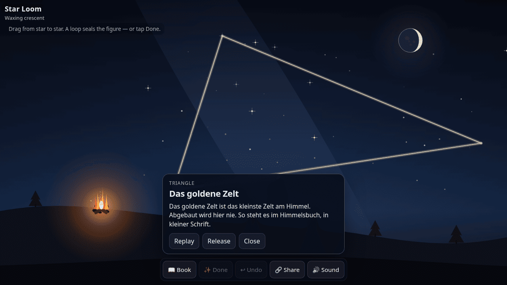

# Star Loom

A night sky you can weave. Stars turn slowly over a dark hill and a campfire. Drag from star to star and the line snaps into place; each star plucks a soft harp note, higher when the star is brighter, always in a pentatonic scale. Close the loop (or tap **Done**) and the figure is read from its geometry: a line, a triangle, a square, a star, a long chain, a ring, a hook, an arc, a cross, a crown or a dipper. It receives a generated name and a two- or three-sentence legend in German (Swiss spelling). Finished constellations glow, turn with the sky, and can be tapped to hear their melody and read the legend again.

- **Drag** from star to star. A loop seals the figure. **Done** (Enter) seals an open one. **Undo** (Z) lifts the last thread.
- **Tap** a finished constellation to hear it and reread the legend. **Release** lets it go.
- **Book** (B) lists every constellation. **New sky** asks twice, then starts a fresh seed.
- **Shooting stars** cross now and then. Tap one to make a wish; a faint star stays behind.
- The **moon** advances one phase each visit (new, crescent, quarter, gibbous, full, and back).
- **Share** (S) copies a link. The address hash holds the sky seed, the moon, wish stars and constellations.
- **Sound** (M) is off until the first tap. The campfire murmurs and the harp is WebAudio, made in the page.
- The sky is kept on this device (localStorage). A shared link opens that sky instead.

One self-contained `index.html`. No libraries, no network, no sound files. Phone and desktop, portrait and landscape.

