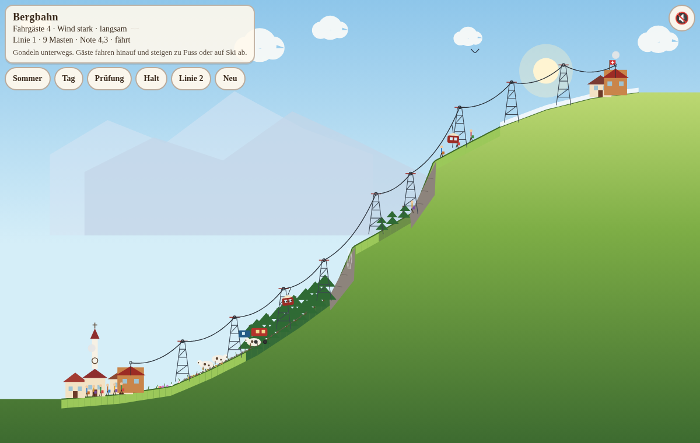

# Bergbahn

A cosy side-view of a Swiss valley. Build a gondola line from the village up to a snowy hut, then let it run.

**Play:** open `index.html` (one file, no network, works on a phone).

## How to play
- **Tippe ins Tal** to set the valley station.
- **Tippe den Hang** to set pylons. The cable hangs as a catenary. A pylon cannot stand on a cliff, sit too close or too far from the last one, or let the cable clip the ground or the trees. A dashed preview shows the next span before you let go.
- **Tippe den Gipfel** for the summit station.
- **Fahren** starts the cabins. They swing when they speed up or when the wind picks up, and a strong gust slows the line. Hikers (summer) or skiers (winter) queue, ride up, and come back down on their own.
- **Linie 2** adds a second line once the first one is finished. A little cogwheel train already climbs the lower slope.
- **Sommer / Winter** and **Tag / Nacht** change the valley. At night the cabins and windows are lit. Cows with bells stay on the meadow in summer.
- **Prüfung** opens the Bauprüfung: cost is the pylons, comfort is the steepest cable angle and the deepest sag, and the two together make a Swiss school note (6 is best).
- **Neu** asks twice, then clears the lines. The passenger tally stays.
- **Ton** (M) is off until the first tap.

Labels are German, Swiss spelling (ss, never ß). The line, the tally, the season and the time of day are kept on this device (localStorage).

## Keys
M sound, N day/night, W season, F run, P Bauprüfung, L second line, R clear, Esc closes the card.

Made by Playbot.
