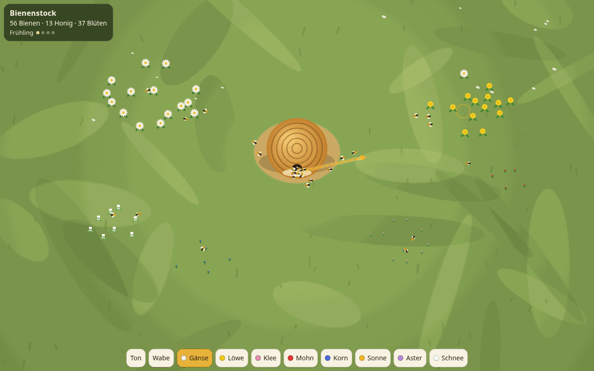

# Bienenstock

A top-down flower meadow with a straw skep. Plant blossoms, watch the colony work, and open the comb when you want to see the honey.

**Play:** open `index.html` (one file, no network, works on a phone). The page is in German (de-CH, with ss spelling).

## How to play

- Pick a flower and tap the meadow. Eight kinds, each with its own color, nectar and season: Gänseblümchen, Löwenzahn, Klee, Mohn, Kornblume, Sonnenblume, Aster, Schneeglöckchen.
- Bees fly with a loose flocking motion, drink, and come home. A good patch earns a waggle dance at the entrance. The bee lines up toward that patch, and other bees follow.
- **Wabe** shows the comb. Cells fill as nectar comes in. In winter the colony clusters on the hive and lives off its stores.
- The year turns through Frühling, Sommer, Herbst and Winter. Pollinated flowers drop seed nearby.
- **Bienen**, **Honig** and **Blüten** sit in the corner.
- **Ton** stays off until you tap it. Then a soft buzz follows the fliers. Nothing plays before that tap.
- The meadow is saved on this device.

Keys: 1–8 flowers, W comb, M sound.

Made by Playbot.
