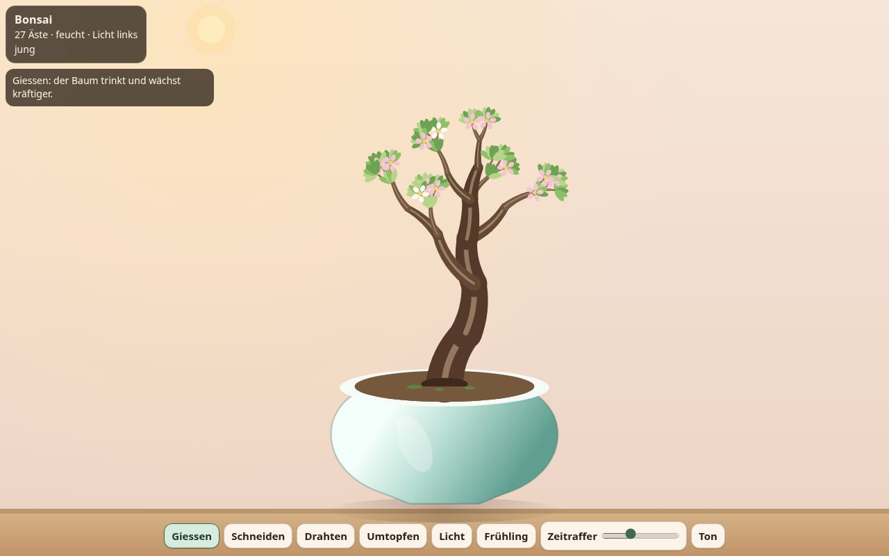

# Bonsai

A small tree in a ceramic pot. It grows while you watch, and it keeps growing slowly between visits.

**Play:** open `index.html` (one file, no network, works on a phone). The page is in German (de-CH, with ss spelling).

## How to play

- **Giessen** gives water. A moist tree grows more strongly. The soil darkens while it drinks.
- **Schneiden:** tap a branch. It falls, and the wood that remains gets thicker and sends out denser, shorter shoots. The trunk stays.
- **Drahten:** drag a branch. A copper wire holds it, and the branch bends toward your hand slowly.
- **Umtopfen** offers six pots: Rund, Oval, Kasten, Kaskade, Sechseck, Schale.
- **Licht** moves the sun. New shoots lean toward the light. Older wood keeps its shape unless you wire it.
- **Jahreszeit** steps through Frühling (blossom), Sommer (full leaf), Herbst (colour) and Winter (bare, with a little snow).
- **Zeitraffer** is a calm slider. Left is slow living growth. Right is a gentle time-lapse. Wind and the wire still move in real time.
- **Ton** stays off until you tap it. Then a soft chime plays now and then, and a snip sounds when you cut. Nothing plays before that tap.

The shape is a branching L-system. Young tips also steer by space colonization: a cloud of attractors sits in the crown, thicker on the lit side, and shoots grow into the gaps. The crown stays pot-sized. When it is full, growth thickens the wood instead of making the tree taller. Pruning opens room again.

The tree is saved on this device (`localStorage`). When you come back, real time away is applied at the calm rate, capped at six hours and a modest flush of new shoots, so a long absence does not rewrite the tree.

Keys: G giessen, S schneiden, D drahten, U umtopfen, L light, J season, T sound.

Made by Playbot.
