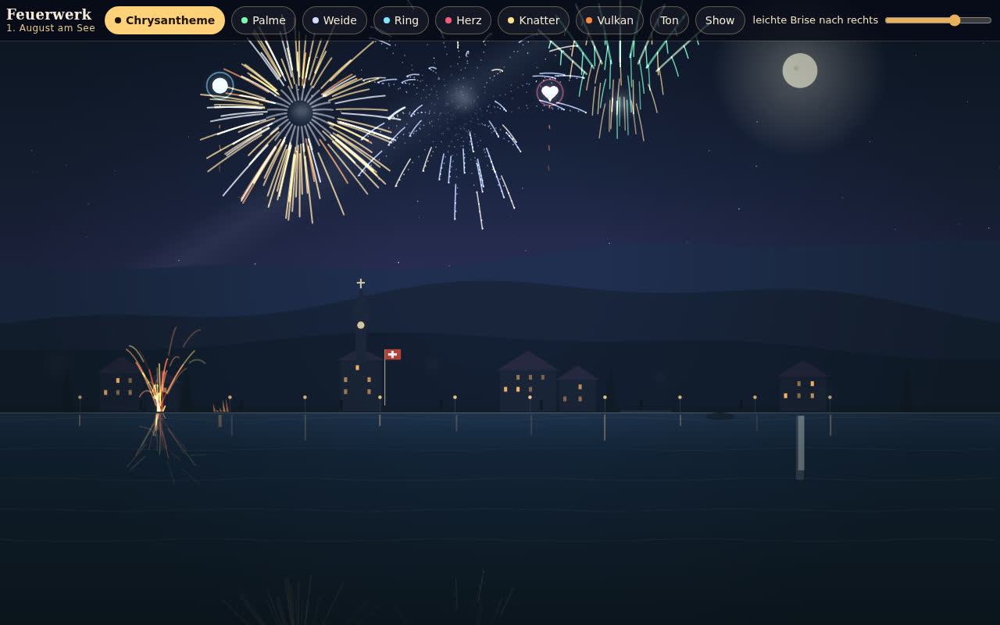

# Feuerwerk

A night over a small lakeside town, in the spirit of the Swiss 1. August. Tap the sky and a rocket climbs. It opens as the shell you picked: a round chrysanthemum, a palm, a willow, a ring, a heart, a crackle, or a shore volcano.

**Play:** open `index.html` (one file, no network, no libraries). The page speaks Swiss German (de-CH, so "ss" and never "ß").

## How to play

- **Tippe** the sky. A rocket leaves the shore and opens where you tapped. **Vulkan** stays on the shore and sprays upward.
- The seven **Körper** are Chrysantheme, Palme, Weide, Ring, Herz, Knatter and Vulkan. Sparks have gravity, drag and fading trails. Smoke drifts with the **Wind**. The lake mirrors the bursts.
- **Ton** stays silent until you tap it. After that, each shell booms, a little later when it is farther away, and Knatter crackles. The sound is made in the page.
- **Show** opens the timeline. Tap it to place the selected shell. Drag a mark to move it, tap it again to remove it. **Abspielen** runs the show, **Fest** loads a ready-made 1. August programme, **Setzen** writes the next sky tap onto the playhead instead of launching it. The show stays on this device.

Keys: 1–7 pick a shell, M sound, S place-mode, space plays the show, arrows change the wind, Esc closes the timeline.

Particles are capped (fewer on a phone) so the show keeps its pace.

Made by Playbot.
