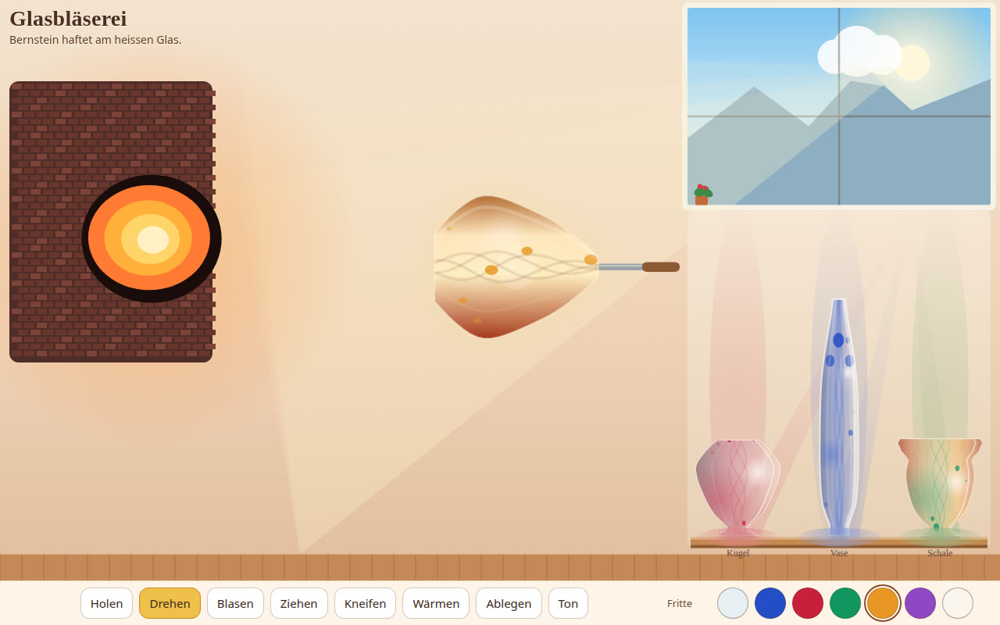

# Glasbläserei

A sunny glassblowing studio. Gather a glowing gob on the pipe, keep it turning, and shape it before it cools clear.

**Play:** open `index.html` (one file, no network, works on a phone). The page speaks Swiss German (de-CH), with double-s spelling.

## How to play

- **Holen** dips the pipe in the furnace and gathers hot glass. Another dip adds a layer.
- **Drehen** rolls the pipe. Hold the button, drag across the glass, or hold the arrow keys. If you stop while the glass is soft, it sags, and if it sags too far it drops onto the bench.
- **Blasen** (hold) inflates the gather. The wall gets thinner as it grows.
- **Ziehen** drags the glass longer, into a neck.
- **Kneifen** pinches or flares the spot under the pointer. Open the lip for a bowl.
- **Fritte** rolls colour onto hot glass: Klar, Kobalt, Rubin, Smaragd, Bernstein, Amethyst, Milch.
- **Wärmen** puts the piece back in the glory hole when it gets stiff.
- **Ablegen** cracks the piece off onto the sunny shelf. It cools from orange to clear glass, and the window light falls through it in colour.
- The shelf keeps up to eight pieces on this device (`localStorage`).
- **Ton** stays off until you turn it on, and the sound only starts after a tap. The furnace hums, blowing is a soft rush of air, and a finished piece rings. All of it is made in the browser.

What you get depends on the shape: a small gather is an Anhänger, a round bubble a Kugel, a long neck a Vase, an open lip a Schale.

Keys: H gather, arrows or A and D roll, space or B blow, Z pull, K pinch, W reheat, Enter set down, F frit, 1–7 colours, M sound.

Made by Playbot.
