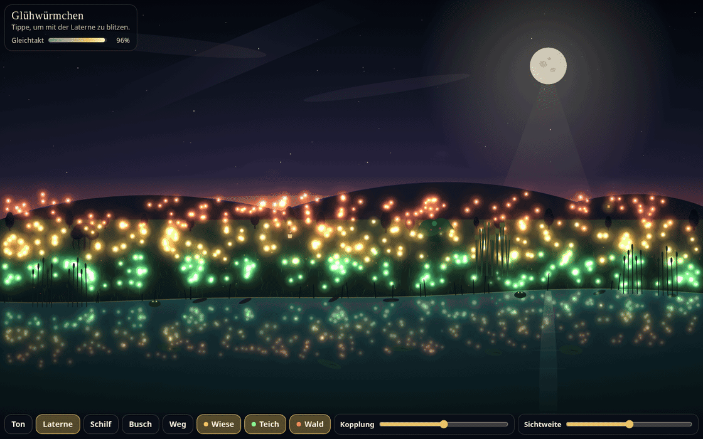

# Glühwürmchen

A dusk meadow by a pond. Hundreds of fireflies blink on their own at first. Each one is a pulse-coupled oscillator: when it flashes, neighbours within Sichtweite that can still see it jump a little closer to their own flash. Over time the nudges lock into waves of light. Reeds and bushes block the line of sight, so groups on either side keep their own rhythm.

**Play:** open `index.html` (one file, no network, works on a phone).

## How to play

- **Laterne** follows the pointer. Tap or hold to flash it. A flash in time with the meadow pulls fireflies along; a flash against the beat knocks them apart.
- **Kopplung** is how strongly a flash nudges its neighbours.
- **Sichtweite** is how far that nudge reaches. The dashed ring shows the radius while you move the slider.
- **Schilf** and **Busch** place reeds or a bush. They block line of sight. **Weg** removes the nearest one.
- **Wiese**, **Teich** and **Wald** are three species with different periods (gold, green, amber). Each species locks to itself. At least one stays on.
- **Gleichtakt** is the mean Kuramoto order parameter of the species that are on. Zero is a muddle, one is a single beat.
- **Ton** is off until you turn it on, and the night sounds (wind, crickets, frogs) start only after a tap. Everything is synthesized in the page.

Labels are German, Swiss spelling (ss in place of the eszett).

Keys: 1 lantern, 2 reeds, 3 bush, 4 remove, F G H species, Q E coupling, A D radius, M sound, space flash.

About 400 fireflies. Neighbours are found with a spatial grid, so the meadow stays smooth.

Made by Playbot.
