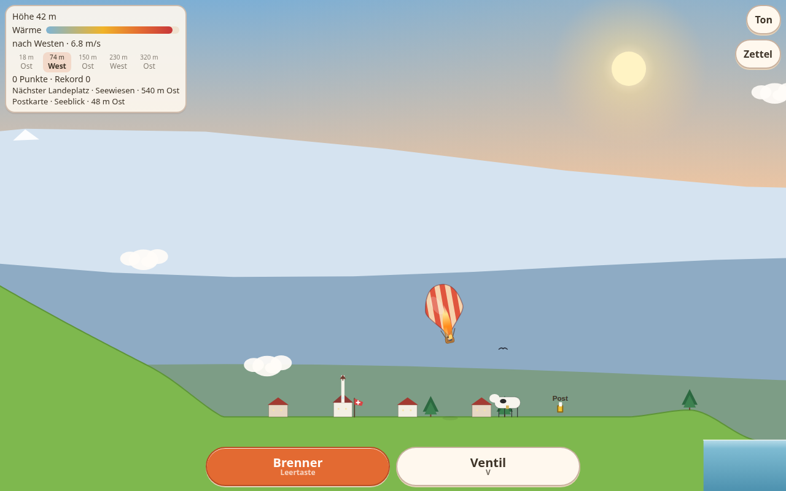

# Heissluftballon

A quiet morning over a Swiss valley. You pilot a hot-air balloon and can only change altitude. The wind is different in each layer, so the way you steer is by climbing or sinking.

**Play:** open `index.html` (one file, no network, works on a phone).

## How to play
- **Brenner** (hold) heats the envelope. The flame roars, the air gets lighter, and the balloon rises.
- Let go and it cools. **Ventil** (hold) dumps hot air so you sink sooner.
- Clouds, chimney smoke, church flags, windsocks and the wind card all move with the wind at their own height. The highlighted row is the layer you are in.
- **Landeplatz** meadows are marked 1 to 5. A gentle touchdown scores up to 100 points. Too fast, and it does not count. The lake and the power lines are not places to land.
- Pick up the **Postkarte** low and slow over the yellow post box in Seeblick, and deliver it the same way in Bergli.
- **Freiflug** is an open morning. **Ausflug** asks for all five meadows and then opens the Punktezettel.
- **Ton** is off until the first tap. Church bells, a cowbell and the burner are synthesized in the browser. M toggles the sound.
- The best total is kept on this device (localStorage). 540 is a perfect Ausflug: five landings and the postcard.

Labels are German, Swiss spelling (ss).

## Keys
Space or the up arrow heats, V or the down arrow opens the valve, M is Ton, Esc closes the Punktezettel.

Made by Playbot.
