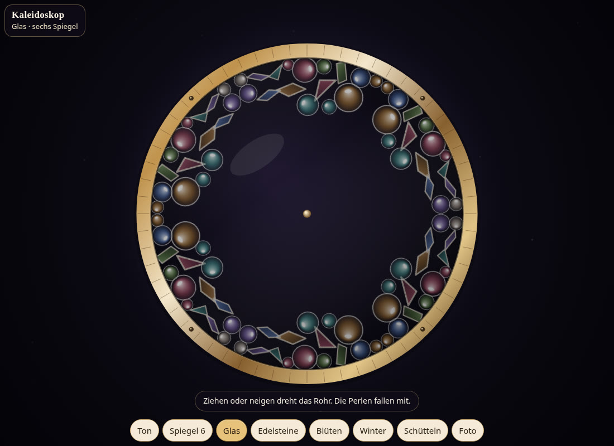

# Kaleidoskop

A brass tube you can turn. Loose beads and shards tumble in one wedge, and the mirrors repeat them live around the circle.

**Play:** open `index.html` (one file, no network, works on a phone). The page speaks Swiss German (de-CH), with ss in place of the eszett.

## How to play

- **Ziehen** on the glass, or the arrow keys, turns the tube. On a phone, **neigen** does the same. The beads keep falling toward the bottom of the screen, so they roll as the mirrors sweep past.
- **Spiegel** steps the symmetry through 3, 4, 6 and 8. The same pieces are folded back into the new wedge.
- **Glas**, **Edelsteine**, **Blüten** and **Winter** swap the objects in the cell: stained glass, cut stones, petals and leaves, or ice and snowflakes.
- **Schütteln** throws everything up the tube.
- **Foto** saves a PNG of the view.
- **Ton** is off until you turn it on, and only after a tap. Then a soft chime rings now and then, with a small tick when a piece hits hard. Everything is synthesized in the page.

The last symmetry and the last set are kept on this device.

Keys: M sound, S symmetry, F photo, 1–4 sets, space shake, arrows turn.

Made by Playbot.
