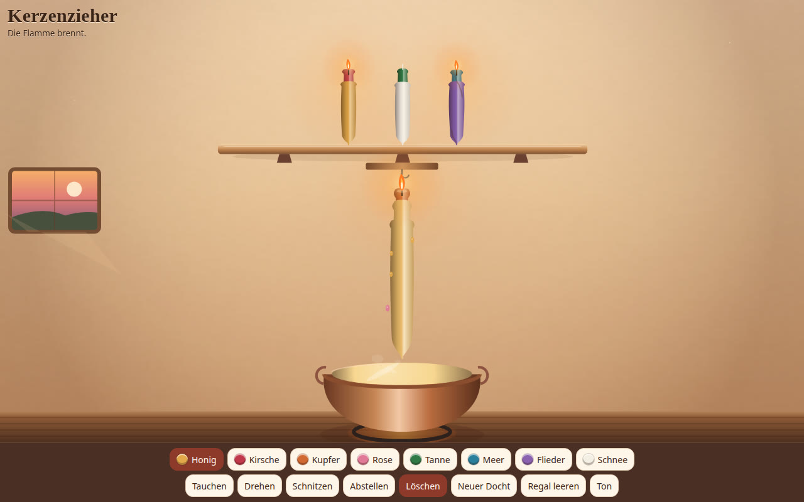

# Kerzenzieher

A warm candle workshop. Pick a wax, dip the wick, and watch the candle grow a ring at a time.

**Play:** open `index.html` (one file, no network, works on a phone). The page speaks Swiss German (de-CH, so "ss" and never "ß").

## How to play
- **Wachsfarben** fill the kettle: Honig, Kirsche, Kupfer, Rose, Tanne, Meer, Flieder, Schnee. The next dip wears that colour.
- **Tauchen**, or drag the wick down into the wax. Each dip adds a layer. The shoulders stay visible as rings, so a shorter dip leaves the colour underneath. Fresh wax shines, then cools and goes matte. Drops run off and fall back into the kettle.
- **Drehen** twists the candle. Drag sideways for a spiral, or dip again and the new layer winds on.
- **Schnitzen** cuts a groove. Drag along the candle and the colour under the outer coat shows through. The next dip covers the cut.
- **Abstellen** stands a finished candle on the shelf. **Anzünden** lights the one on the hook; tap a candle on the shelf to light or snuff it. Flames flicker and throw a warm glow.
- **Neuer Docht** starts again. If the hook still holds wax, you can shelve it or throw it out. **Regal leeren** clears the shelf after a question.
- **Ton** stays off until you tap it. Then a dip, a drop, a scrape and a flame make a small sound, synthesized in the browser. Nothing plays before that tap.

The kettle, the candle on the hook and the shelf are saved on this device (`localStorage`).

Keys: 1–8 pick a wax, T dip, D twist, C carve, A shelve, L light, N new wick, R clear the shelf, M sound, Esc closes a question.

Made by Playbot.
