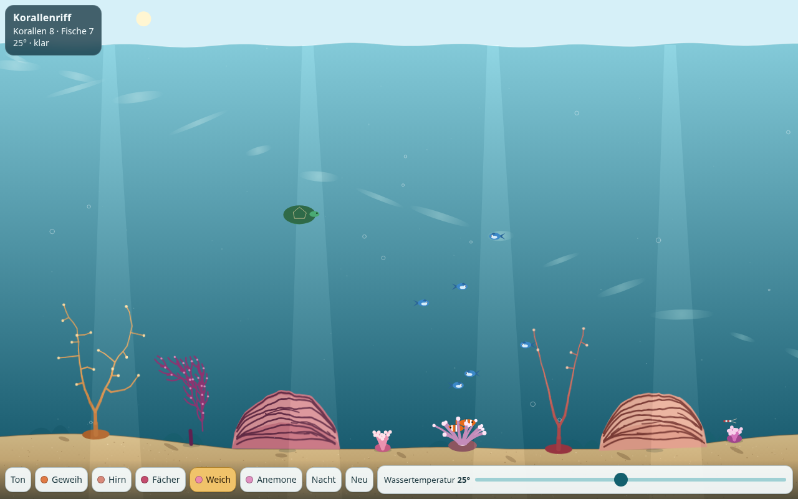

# Korallenriff

A calm side view of a shallow sea. Settle coral larvae on the sand and watch a reef grow. Keep the water cool.

**Play:** open `index.html` (one file, no network, works on a phone). The page is in Swiss German (de-CH, with ss spelling).

## How to play

- Pick a coral, then tap the seabed. A larva sinks and takes hold. **Geweih** is a branching staghorn (space colonisation along an antler of attractors). **Hirn** is a brain coral, a mound built by diffusion-limited growth with wandering grooves. **Fächer** is a gorgonian fan grown from an L-system. **Weich** is a soft coral that sways. **Anemone** is a home for clownfish.
- Fish arrive as the reef fills: a school that flocks together, a turtle on a slow cruise, clownfish in the tentacles, and cleaner shrimp walking the branches. A fish will pause beside a shrimp.
- **Wassertemperatur** is the slider. Past about 29° the corals bleach toward white, growth slows, and the fish leave. Cool the water and the colour comes back; the fish return.
- **Nacht** darkens the sea. Polyps and plankton glow. **Tag** brings the light and the caustic ripples back.
- **Ton** stays off until you turn it on, and the sound starts only after a tap. Then a quiet burble of bubbles plays, made in the browser.
- **Neu** asks once, then clears the sand.
- The reef is saved on this device.

Keys: 1–5 choose a coral, N night, M sound, 0 clear, up and down change the temperature.

Made by Playbot.
