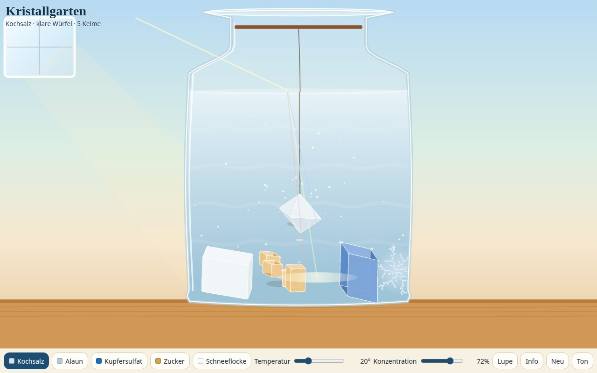

# Kristallgarten

A jar of supersaturated solution on a sunny sill. Pick a salt, tap the glass, and a seed sinks — onto the thread, or down to the bottom — and starts to grow.

**Play:** open `index.html` (one file, no network, works on a phone). The page speaks Swiss German (de-CH, so "ss" and never "ß").

## How to play
- **Tippe** the jar. A seed drops through the neck. Near the thread it slides down and hangs; off to the side it settles on the glass.
- **Temperatur** and **Konzentration** change how fast the crystals grow and which habit you get. Hot and dilute, they slowly dissolve again. The solution in the jar is the salt you have selected; crystals already growing keep their own shape.
- **Lupe** is a magnifying glass. It follows the pointer and shows that spot larger.
- **Info** is a short, kid-friendly note on the selected salt.
- **Neu**, then **Leeren?**, empties the jar.
- **Ton** stays silent until you have tapped the page and turned it on. Then a seed landing, and a new layer of crystal, makes a tiny glassy tink. The sound is synthesized in the browser.

The jar, the sliders, and every crystal are saved on this device (`localStorage`).

## What each salt grows
- **Kochsalz** — cubes, by faceted growth. In a very full solution the corners run ahead of the faces and the cube becomes a hopper (Trichterwürfel). Warm solution blunts the corners.
- **Alaun** — octahedra, two pyramids base to base. Warmth truncates the tips.
- **Kupfersulfat** — blue oblique prisms. Colder, more concentrated solution makes them longer. The blue is the copper letting blue light through.
- **Zucker** — a little cluster of skewed blocks, like Kandiszucker. The molecules are bulky, so the faces stay less perfect than salt.
- **Schneeflocke** — six-fold dendrites grown by diffusion-limited aggregation. Walkers wander until they stick. Tips catch them before the gaps do, so the arms get spikier. Warmer or less concentrated solution fills in toward a hexagonal plate.

A beam from the window bends as it enters the solution (air into water) and splits a little. Sparkles sit on the facets and on the glass.

Keys: 1–5 pick a salt, L loupe, I info, N clear, M sound, Esc closes the card.

Made by Playbot.
