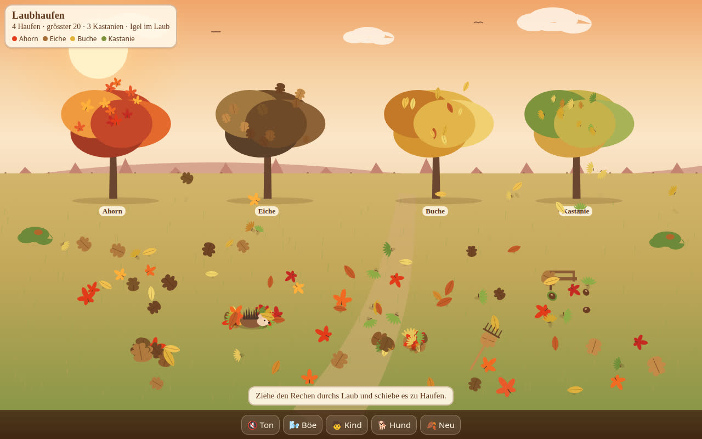

# Laubhaufen

An autumn garden. Four trees shed their leaves: Ahorn, Eiche, Buche and Kastanie. Gusts swirl them, chestnuts drop, and a hedgehog may settle into a deep pile.

**Play:** open `index.html` (one file, no network, works on a phone). The page speaks Swiss German (de-CH, with ss spelling and no eszett).

## How to play

- Drag across the lawn. The rake pushes the leaves into piles. They flutter, spin and settle.
- **Böe** sends a gust. Leaves swirl, and the top of a pile can lift off.
- **Kind** and **Hund** run in and jump into the biggest pile, scattering it. Now and then one of them visits on their own.
- A hedgehog may hide in a deep pile. Rake through it, or let someone jump in, and he scurries into the bushes. He may come back.
- Chestnuts drop from the Kastanie. The rake pushes those too.
- **Neu** scatters the garden again.
- **Ton** stays off until the first tap. Tap Ton again to mute. After that: a rustle, the wind, a soft plop when a chestnut lands, and the jump.
- The biggest pile is kept on this device.

Keys: M sound, B gust, K child, H dog, N again.

Made by Playbot.
