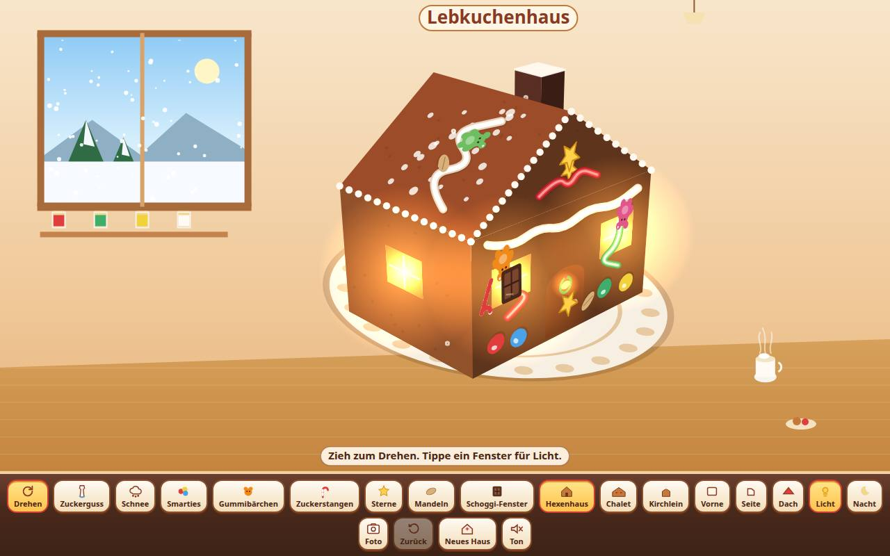

# Lebkuchenhaus

A cosy kitchen table, and a gingerbread house you can turn and decorate. For children about 4 to 8, and anyone who likes icing.

**Play:** open `index.html` (one file, no network, works on a phone). The page is in German (de-CH, with ss spelling).

## How to play

- **Drehen** and drag the house. **Vorne**, **Seite** and **Dach** turn it to the front, the side or the roof. Decorations stay on the wall or the roof they were stuck to.
- **Zuckerguss** draws a smooth piping line. Weiss, Rosa, Rot, Grün, Blau or Gelb.
- **Schnee** dusts powdered sugar.
- **Smarties**, **Gummibärchen**, **Zuckerstangen**, **Sterne**, **Mandeln** and **Schoggi-Fenster** stick where you tap.
- Tap a window, or press **Licht**, and the inside glows warm. **Nacht** darkens the kitchen; the house glows, and snow keeps falling outside the window.
- **Foto** saves a PNG. **Zurück** undoes a step. **Neues Haus** clears the decorations (Zurück can bring them back).
- **Hexenhaus**, **Chalet** and **Kirchlein** are three different houses. Switching shape starts the decorations over; Zurück returns the previous house.
- **Ton** stays off until you tap it. The first time it is on, a short jingle plays. Nothing plays before that tap.
- The house is saved on this device.

Keys: arrows turn the house, Ctrl+Z or Cmd+Z undoes, Esc closes the question.

Made by Playbot.
