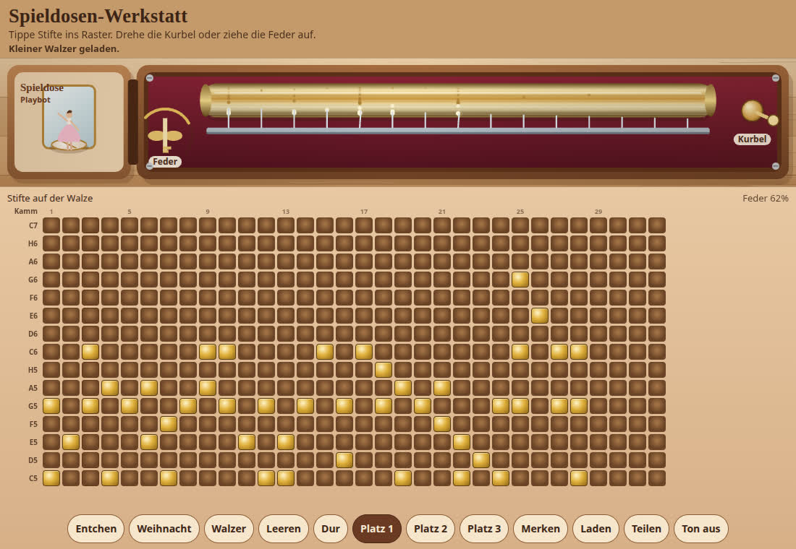

# Spieldosen-Werkstatt

A music box on a wooden bench, seen from above. Punch pins into the brass cylinder, then turn it: drag the crank for a live tempo, or wind the spring key and let go. The spring slows as it runs down. Fifteen steel teeth bend and ring with a small metallic voice (inharmonic partials, a short FM bloom, a soft decay, each tooth a hair out of tune). A dancer on the lid turns with the cylinder.

The comb can be retuned. **Dur**, **Pentatonik**, **Moll**, or a Swiss folk-ish **Mixolydisch**. The pins stay put; the notes change.

- Tap a cell in the grid to add or remove a pin. High notes are at the top. Arrow keys move between cells.
- **Kurbel**: drag the crank on the right. One turn of the handle is one turn of the cylinder.
- **Feder**: drag the key clockwise to wind it, then let go. It plays on its own and slows down. Space pauses the spring.
- **Entchen**, **Weihnacht**, **Walzer**: three short cylinders. Alle meine Entchen, Morgen kommt der Weihnachtsmann (the Twinkle tune), and a little original waltz. All three are public-domain melodies or an original, squeezed onto 32 steps.
- **Merken** / **Laden**: three slots on this device (localStorage).
- **Teilen**: copies a link. The hash stores the scale and every pin.
- **Ton**: sound stays off until the first tap. M toggles it. S changes the scale.

Labels are German as used in Switzerland: double s, and no eszett. One self-contained `index.html`, no libraries and no network requests.

