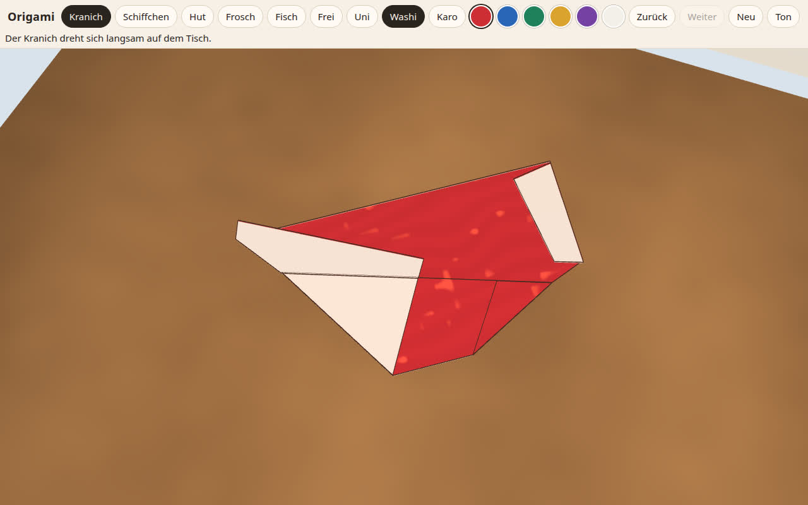

# Origami

A square of paper on a wooden table. Fold it into a crane, a boat, a hat, a frog or a fish, or crease it however you like.

**Play:** open `index.html` (one file, no network, works on a phone). The page speaks Swiss German (de-CH, with ss and never ß).

## How to play

- **Kranich**, **Schiffchen**, **Hut**, **Frosch** and **Fisch** are guided models. A glowing line marks the next crease. **Zieh** along that line and the sheet folds. **Weiter** does the same step. **Zurück** undoes it.
- The last step shapes the model in 3D: the crane lifts its neck, the boat raises its walls, the hat curls its brim, the frog sits up, the fish lifts a fin. The finished model turns slowly on the table.
- **Frei** lets you drag a corner or the middle of an edge. The crease is the perpendicular bisector between where the point was and where your finger is. Let go past halfway and the fold stays.
- **Uni**, **Washi** and **Karo** change the paper. The round swatches pick the colour. The back of the sheet is cream, so a valley fold shows the other side.
- **Ton** stays off until you tap it. Only then does a fold rustle. The rustle is synthesized in the page. Nothing plays before that tap.
- **Neu** puts a fresh square on the table.

Keys: 1–5 pick a model, 6 is Frei, Enter or right arrow folds, left arrow or Backspace undoes, N starts over, T is the sound, U W K pick Uni, Washi and Karo.

Made by Playbot.
