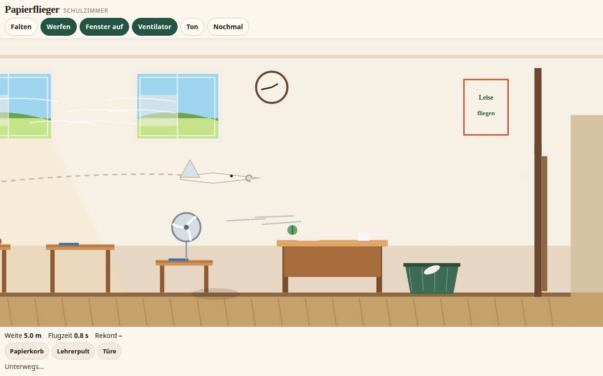

# Papierflieger

Fold a paper plane, then flick it down the Schulzimmer.

**Play:** open `index.html` (one file, no network, works on a phone). The page speaks Swiss German (de-CH, so "ss" and never "ß").

## How to play
- **Falten** picks a model: Pfeil, Gleiter, Stuntflieger, or Haifisch. Spannweite, Nase, Flossen (Winglets) and Gewicht (a Büroklammer on the nose) reshape it. The live view shows the plane from above and from the side. The green dot is the Schwerpunkt, the blue dot is the Auftrieb. Ahead of the lift, it glides. Behind the lift, it pitches up and can fly a Schlaufe.
- **Werfen** is the classroom, seen from the side. Wische to throw (a slow drag aims it too). Desks, the Lehrerpult, the Papierkorb and the Türe are in the way. A bad fold stalls or dives. A Stuntflieger can loop. A Büroklammer on the nose calms it down.
- **Fenster auf** lets in a draft. **Ventilator** blows across the middle of the room.
- **Aufgaben:** land in the Papierkorb, settle on the Lehrerpult, or fly out through the Türe.
- Weite and Flugzeit are kept per model on this device (localStorage).
- **Ton** is off until you turn it on, and only after the first tap. Then a paper rustle and a whoosh, made in the browser.

Keys: 1–4 pick a model, F fold, W throw, Space throws, arrows tilt that throw, O window, V fan, M sound, N again.

Made by Playbot.
