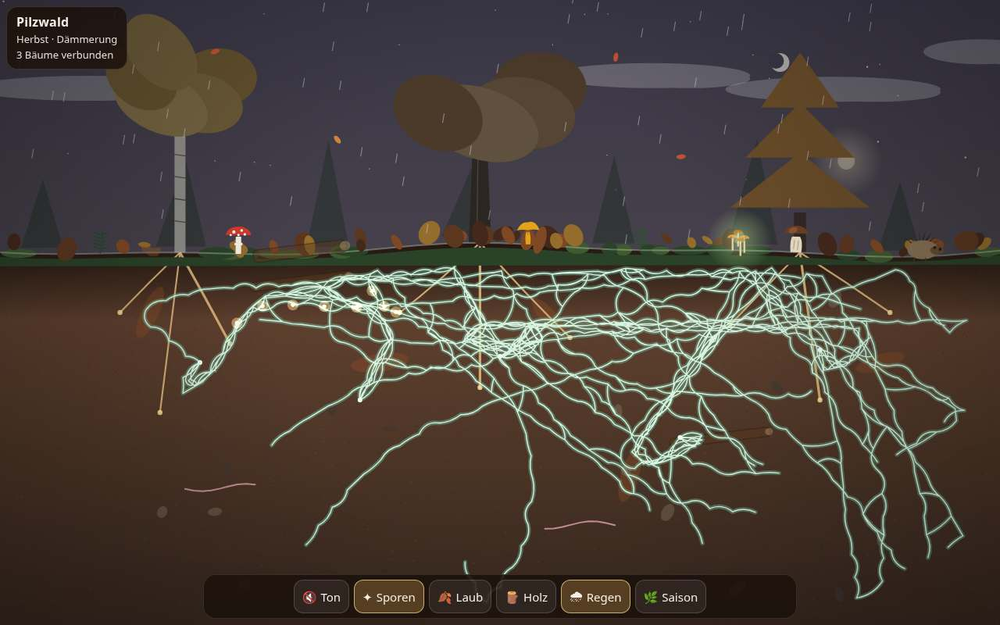

# Pilzwald

A quiet cross-section of the forest floor. Above the moss: birch, beech, spruce, leaf litter, and a hedgehog. Under it, the soil, where spores become a glowing net.

**Play:** open `index.html` (one file, no network, works on a phone). The page is in German (de-CH, with ss spelling).

## How to play

- **Sporen**, then tap the soil. Hyphae grow as branching tips. They wander, steer toward fallen leaves and wood (a small space-colonisation), and fuse when they meet (anastomosis).
- Leaves and logs already lie in the ground. **Laub** and **Holz** add more.
- When the net reaches two trees, pulses of light carry food along it. A thirsty tree steadies and greens again.
- **Regen** wets the floor. Mushrooms then fruit above the moss: Fliegenpilz, Steinpilz, Pfifferling, and Hallimasch, which glows at night. Tap a mushroom, or the hedgehog, for a short note.
- The day turns on its own, and **Saison** steps Frühling, Sommer, Herbst, and Winter.
- **Ton** stays off until you tap it. Rain and the forest only start after a tap. The sounds are made in the page.
- The wood is saved on this device.

Keys: M sound, 1 spores, 2 leaves, 3 wood, R rain, S season, Esc closes a note.

Made by Playbot.
