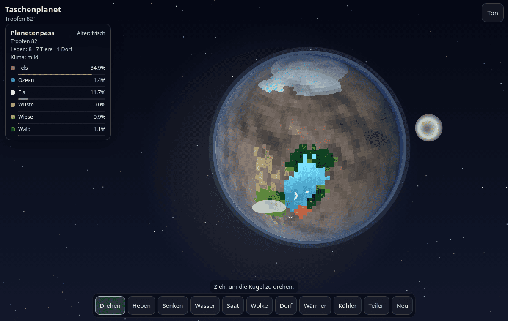

# Taschenplanet

A tiny round planet floating in space. Drag to spin it. It starts as bare rock. Shape the land, pour water into the lows, and watch a climate, a tide and a little ecology do the rest.

**Play:** open `index.html` (one file, no network, works on a phone).

## How to play

- **Drehen** — drag the planet. Two fingers always spin, even when another tool is active. The sun stays put, so one side is day and the other night.
- **Heben / Senken** — raise mountains or dig valleys.
- **Wasser** — pour water. It runs downhill and settles as lakes and oceans. Shallow shores breathe with the tide.
- **Saat** — plant. Plants keep growing where it is moist and mild, and fade in ice or strong heat.
- **Wolke** — set a cloud. Rain wets the ground and plants spread outward.
- **Wärmer / Kühler** — shift the climate. Ice caps grow or shrink. Deserts and forests follow the temperature.
- **Dorf** — place a village. It only takes root near water and forest, then grows and lights its windows on the night side.
- A small moon orbits the planet and pulls the tide toward itself.
- Deer, birds and fish appear once a forest or an ocean is rich enough, and fade if that biome goes away.
- **Planetenpass** shows biome shares, life, climate and age.
- **Teilen** copies a link. The address hash holds the seed and every edit, compressed. The planet is also kept on this device (localStorage).
- **Ton** is off until the first tap. After that, a soft generative pad follows how alive the planet is. All sound is made in the page.
- **Neu** asks, then forms a fresh planet.

Labels are German, Swiss spelling (ss in place of the eszett).

Keys: 1 spin, 2 raise, 3 lower, 4 water, 5 seed, 6 cloud, 7 village, + warmer, − cooler, M sound, S share, N new, arrows spin.

One self-contained `index.html`. No libraries, no network, no sound files. Phone and desktop, portrait and landscape. The sphere is a lat-long heightmap drawn as shaded pixels.

Made by Playbot.
