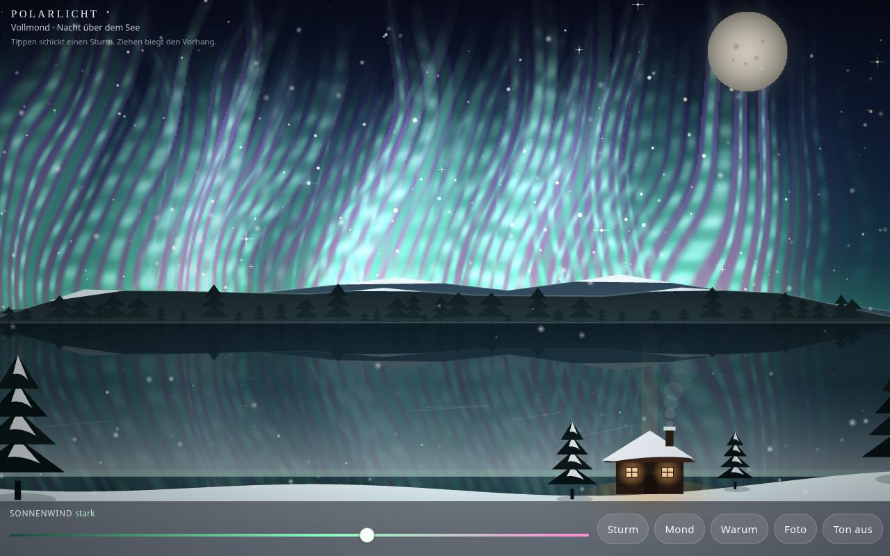

# Polarlicht

A quiet northern night. Curtains of light fold over a frozen lake, pines stand in the dark, and a cabin keeps one warm window.

**Play:** open `index.html`. One file, no libraries, no network. The screen is Swiss German, with ss where German would use an eszett.

- **Sonnenwind** is the solar wind. Low is a thin green veil. Higher brings pink and violet edges, then a red fringe.
- **Tap the sky** or press **Sturm** for a burst: coronas and a slow pulse through the curtains.
- **Drag** to bend the curtain. It eases back on its own.
- **Mond** steps through the phases.
- **Warum** tells, in plain German, why the light is green and red.
- **Foto** saves a PNG of the scene.
- **Ton** stays off until you tap it. Then a soft drone, made in the browser, follows the wind.

Stars, shooting stars and snow are always there. If WebGL is missing, the curtains are drawn with canvas. On a slow device the picture gets a little softer so the frame rate can stay high.

Phone and desktop, portrait and landscape, touch and mouse.

