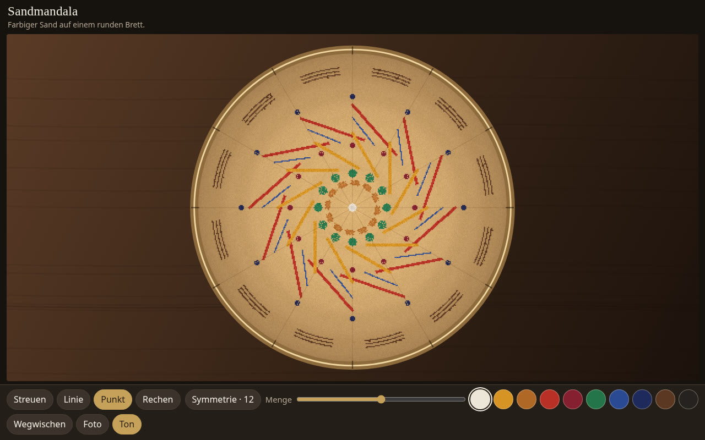

# Sandmandala

A small sand mandala. Pour coloured sand on a round board and it repeats around the centre, then piles and slides a little.

**Play:** open `index.html` (one file, no network, works on a phone). The page speaks Swiss German (de-CH, with ss spelling).

## How to play
- **Streuen** sprinkles sand while you drag or hold. **Linie** draws a straight stroke (it lands when you let go). **Punkt** sets a mound. **Rechen** pulls a comb: several tines leave parallel traces.
- **Symmetrie** switches the board between 6, 8 and 12 fields. Every grain is copied once into each field.
- **Menge** is how much sand the tool lays down: a thin line, a usual mound, or a heavy pour. Piles that stand too steep slide one grain toward a lower neighbour.
- **Pigmente** are mineral colours: Kreide, Safran, Ocker, Zinnober, Krapplack, Malachit, Lapis, Indigo, Umbra, Kohle.
- **Wegwischen** is the closing ritual. Tap once, then again: the sand spirals into the centre and the board is clear.
- **Foto** downloads a PNG of the board.
- **Ton** stays off until you turn it on, and only after the first tap. Then pouring trickles, and Wegwischen strikes a singing bowl. Both are made in the browser.

The board is kept on this device (`localStorage`), including the tool, the pigment, the symmetry and whether Ton is on.

Keys: 1 streuen, 2 linie, 3 punkt, 4 rechen, S symmetry, `[` `]` amount, W wipe, F photo, M sound, Esc cancels the wipe question.

Made by Playbot.
