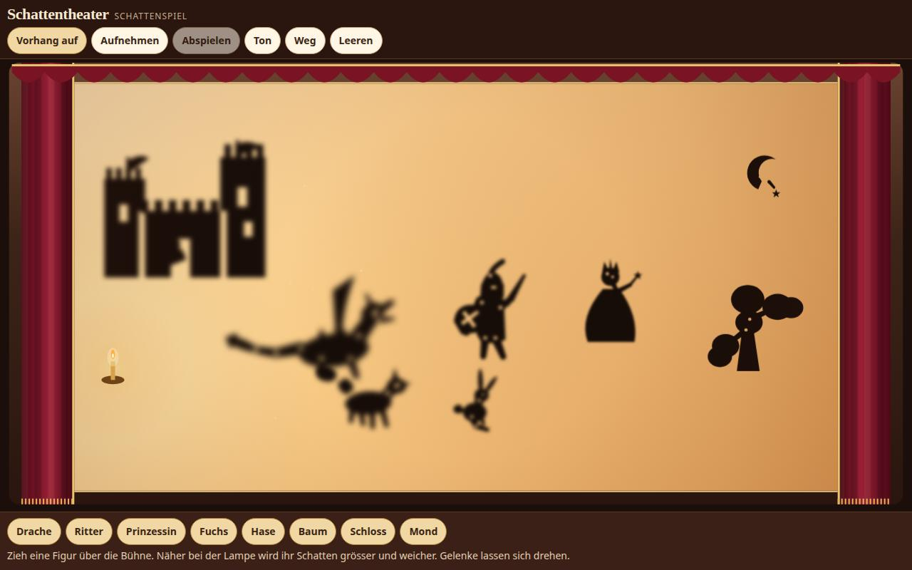

# Schattentheater

A paper screen, a warm lamp, and shadow puppets for children. Move a figure toward the lamp and its shadow grows bigger and softer. Far from the lamp it gets smaller and sharper. Limbs swing on their joints.

**Play:** open `index.html` (one file, no network, works on a phone). The page speaks Swiss German (de-CH, so "ss" and never "ß").

## How to play

- **Drache**, **Ritter**, **Prinzessin**, **Fuchs**, **Hase**, **Baum**, **Schloss** and **Mond**: tap a figure to set it on the stage, or drag it from the bar onto the paper.
- Drag a figure to move it. Drag a limb (arm, wing, tail, ear, flag) to bend that joint. Moving the whole figure makes the limbs swing.
- **Vorhang** opens and closes the curtain.
- **Aufnehmen** records the movement for six seconds, closes and opens the curtain, and plays the little show. **Abspielen** plays it again. During a recording or a show the button says **Stopp**.
- **Weg** removes the selected figure. **Leeren** clears the stage.
- **Ton** stays off until you turn it on, and only after a tap. Then a soft music-box tune plays, and the curtain makes a swish. Nothing plays before that.
- The figures, the curtain and the last show are saved on this device (localStorage).

Keys: 1–8 choose a figure, arrows nudge the selected one, V curtain, A record, Space play, M sound, Delete removes, Esc stops.

Made by Playbot.
