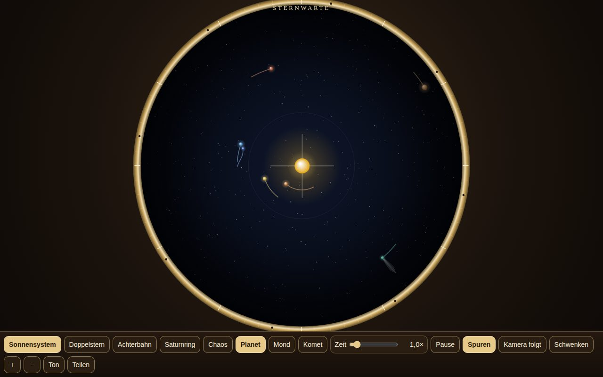

# Sternwarte

A gravity sandbox seen through an observatory telescope. Flick planets, moons and comets into orbit around a star, or load a preset and watch the sky move.

**Play:** open `index.html` (one file, no network, works on a phone). The page speaks Swiss German (de-CH, so "ss" and never "ß").

## How to play

- **Ziehen** on the glass sets the launch speed. A dotted line shows the predicted path. Planet, Mond or Komet chooses what you throw.
- **Tippen** a body opens a small card: Masse, Geschwindigkeit, and an Umlaufzeit estimate (Schätzung). Entfernen removes it.
- **Zeit** speeds or slows the sky. **Pause** / **Weiter** holds it. **Spuren** draws fading trails.
- **Näher** and **Ferner** (+ / −), the wheel, or a pinch zoom the eyepiece. **Schwenken**, a right-drag, or two fingers pan. **Kamera folgt** tracks the selected body (or the brightest, if none is selected).
- Presets: **Sonnensystem** (a scaled system with a moon and a comet), **Doppelstern**, **Achterbahn** (the figure-8 three-body dance), **Saturnring** (about 500 dust grains that feel the star and the planet, but not each other), **Chaos**.
- Bodies that touch merge, keep their momentum, and flash. Comets grow a tail pointing away from the star.
- The integrator is velocity Verlet with a small softening length, so a quiet Sonnensystem keeps its energy.
- **Ton** is off until you turn it on, and only after the first tap. Then a soft space drone, made in the page, sits under the glass.
- The scene is kept on this device (`localStorage`). **Teilen** writes it into the address hash and copies the link.

Keys: 1–5 presets, space pause, +/− zoom, F follow, M sound, S share, Esc closes the card.

Made by Playbot.
