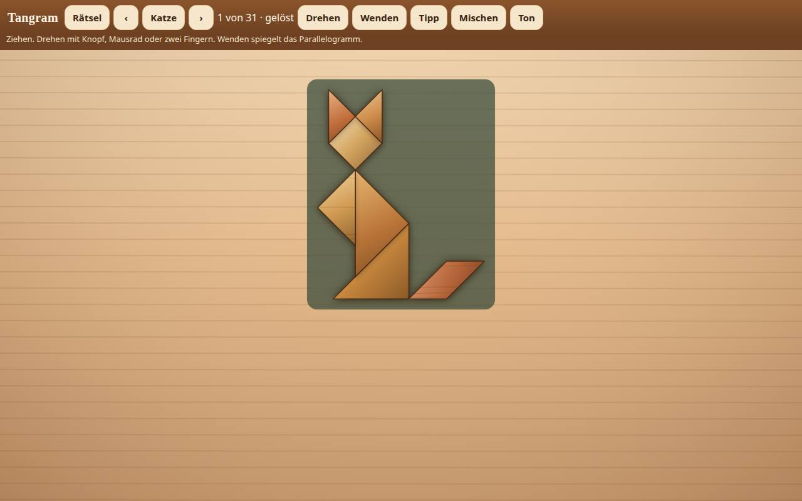

# Tangram

Seven wooden pieces on a table, and a shadow to fill. For children about 5 and up, and anyone who likes a quiet puzzle.

**Play:** open `index.html` (one file, no network, works on a phone). The page is in German (de-CH, with ss spelling).

## How to play

- Drag a piece. **Drehen** turns it by 45 degrees. The mouse wheel and a two-finger twist do the same.
- **Wenden** flips the parallelogram. The other pieces stay as they are.
- Pieces snap when an edge or a corner meets a neighbour, or the shadow.
- **Rätsel** is the puzzle. Cover the dark shape exactly. When it fits, the page says **Geschafft**.
- **Tipp** sets one piece onto its place. **Mischen** scatters them again.
- **Frei** puts the shadow away. Build whatever you like.
- **Ton** stays off until you tap it. The first tap turns on a soft wood click. Nothing plays before that.
- Progress stays on this device (`playbot-tangram-v1` in localStorage): the puzzle, the layout, which figures are solved, and whether Ton is on.

The 31 figures are Quadrat, Dreieck, Pyramide, Pfeil, Herz, Haus, Turm, Tanne, Schiff, Rakete, Flugzeug, Hemd, Fabrik, Ufo, Katze, Pinguin, Vogel, Ente, Schwan, Hahn, Huhn, Flamingo, Fisch, Krebs, Schnecke, Schildkröte, Giraffe, Känguru, Pferd, Läufer and Tänzer.

Keys: arrows change the figure, R turns, W flips, T is the tip, M mixes, Esc closes the list.

Made by Playbot.
