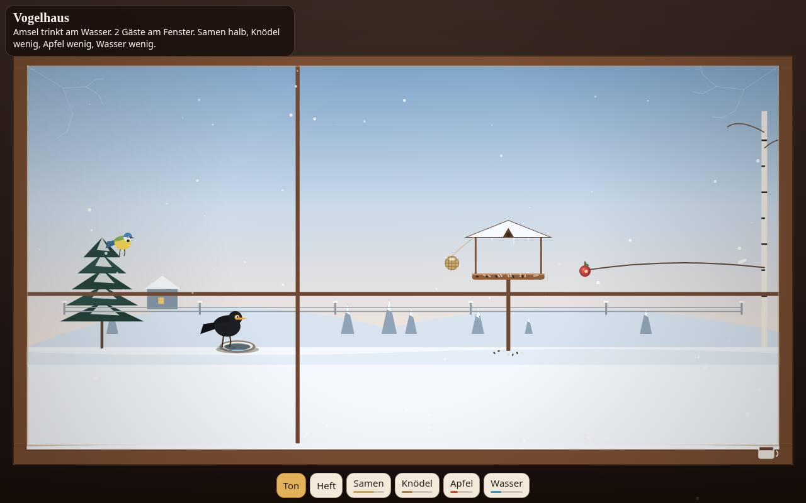

# Vogelhaus

A snowy garden seen through the window. Stock a winter feeder and watch which guests come to the sill.

**Play:** open `index.html` (one file, no network, works on a phone). The page is in Swiss German (de-CH, with ss spelling).

## How to play

- **Samen**, **Knödel**, **Apfel** and **Wasser** fill the house. Not every guest eats the same thing.
- Kohlmeise and Blaumeise take seeds and suet. A Blaumeise may hang under the ball. Rotkehlchen, Gimpel, Buchfink and Amsel come for fruit, spilled seed or the bowl. The Specht clings to the suet. The Eichhörnchen raids the tray and can scare the birds off.
- Guests hop, peck, drink and sometimes squabble. Tap the glass and they flee.
- **Heft** opens a small notebook of sightings. It stays on this device (`localStorage`).
- **Ton** stays off until the first tap. After that you hear a soft chime, a little wind, and short songs made in the browser. Tap Ton again to mute.

Keys: 1–4 fill the food, H opens the notebook, M toggles sound, Esc closes the notebook.

Made by Playbot.
