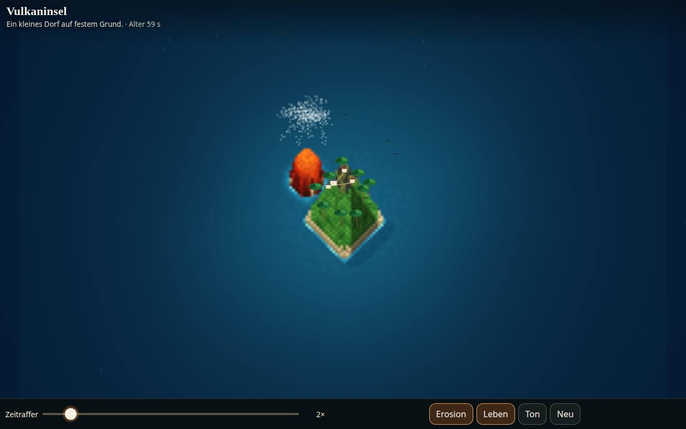

# Vulkaninsel

A top-down ocean where a tap starts an eruption. Lava is a viscous heightfield: it flows downhill, glows while it is hot, hisses into steam on the water, and cools to black basalt. The rock stays, so an island grows. Rain rounds the slopes and leaves beaches. Then lichen, grass and palms take the cooled ground, birds arrive, and a tiny village appears on land that has stayed quiet.

**Play:** open `index.html` (one file, no network, works on a phone). The page speaks Swiss German (de-CH, so "ss" and never "ß").

## How to play

- **Tippe** the sea to open a vent. Hold and drag to draw a fissure. Lava runs downslope and piles up until it stands above the water.
- **Zeitraffer** runs the same sim faster, from 1× to 12×.
- **Erosion** lets rain wear the high ground down. Sediment settles on the shallow shore as beach.
- **Leben** lets cooled land age: flechten, then grass, then palms. Birds circle once there is enough green. A village builds on a flat spot that has been stable for a long while. A new flow burns that life back to basalt.
- **Ton** is off until you turn it on. After the first tap the page may play sound: a low rumble while lava is moving, and the sea underneath. All of it is made in the browser.
- **Neu** asks, then starts a fresh sea. The island on this device is replaced.
- The island is kept in `localStorage` (height, lava, heat, life, palms, village).

Keys: M sound, E erosion, L life, N new, `[` `]` change the Zeitraffer.

The grid is 256×256, in typed arrays. Relief is height-shaded, with a sea level, cast shadows and a gentle upward tilt so the cone reads as a small mountain.

Made by Playbot.
