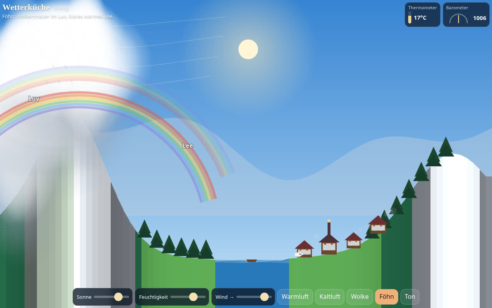

# Wetterküche

A side-view alpine valley you can cook weather in. A lake, a little village and two ridges sit under a simple atmosphere grid of temperature, humidity and wind.

**Play:** open `index.html` (one file, no network, works on a phone). The page speaks Swiss German (ss, never ß).

## How to play

- **Sonne**, **Feuchtigkeit** and **Wind** are the three knobs. Wind to the right blows over the left ridge into the valley.
- **Warmluft**, **Kaltluft** and **Wolke** are brushes. Tap or drag in the sky to drop a warm bubble, a cold bubble, or a seed cloud.
- **Föhn** sends moist air up the windward slope. It piles up as a cloud wall in the **Luv**, rains out, and sinks into the valley as warm, dry air. The **Lee** goes clear and blue. That is the classic Alpine föhn, labelled on the sky while the button is on.
- The sun crosses the sky on its own. At night the valley cools, windows light up, and cold air drains down the slopes.
- A warm slope starts an updraft. The air cools as it rises, moisture condenses, cumulus grow, and a strong tower spreads an anvil. When drops get heavy they fall as rain, or as snow where the air is below freezing. Sun and rain together draw a rainbow. A strong updraft in a wet cloud throws lightning.
- The panel shows a valley **Thermometer** (°C) and a **Barometer** (hPa). Touch the sky to read the air right there.
- **Ton** is off until the first tap. After that the valley plays wind, rain, a few birds, a distant bell and thunder, all made in the page. Tap Ton again to mute.

Keys: 1 warm air, 2 cold air, 3 cloud, F föhn, M sound.

One self-contained `index.html`. No libraries, no network, no sound files. Phone and desktop, portrait and landscape, touch and mouse.

Made by Playbot.
