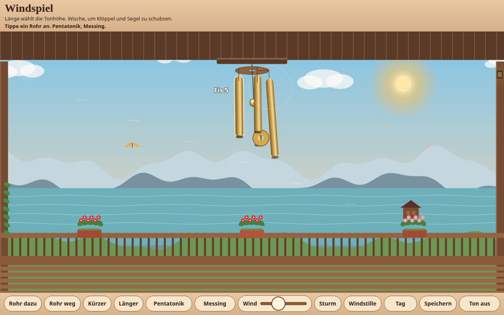

# Windspiel

A porch wind chime on a balcony. Hang tubes from the beam, plus the clapper and the sail. Tube length picks the pitch. Wind comes in gusts, or you swipe the view and push the sail yourself. When the clapper strikes a tube it rings, and a ripple shows even if the sound is off.

The page speaks Swiss German (de-CH): umlauts are fine, the eszett is not used.

## Play

Open `index.html`. One file, no libraries, no network.

- **Rohr dazu** / **Rohr weg** hang or take down a tube (one to eight).
- **Kürzer** / **Länger** change the selected tube. Shorter is higher. Tap a tube to choose it, and to strike it by hand.
- **Pentatonik**, **Dur**, **Moll**, **Japanisch**, **Gamelan** retune the same tubes. Japanisch is an in scale. Gamelan is a slendro-like tuning, a few cents off the piano.
- **Bambus**, **Messing**, **Glas** change colour and voice.
- **Wind** sets the breeze. **Sturm** turns on hard gusts. **Windstille** lets everything settle.
- **Tag** / **Nacht** fades the balcony.
- **Speichern** keeps the chime on this device (localStorage). It also saves itself when you change it.
- **Ton** stays off until the first tap. Tap Ton again to mute. M does the same. Arrows push or retune. N toggles day and night.

Pitches follow the tube: a free bar rings at `1 / Länge²`, so the drawn length matches the note. The voice is a struck metal bar, not a flute. Partials sit at the free-free bending ratios **1 : 2.756 : 5.404 : 8.933**, each with its own decay. Brass keeps the upper partials, bamboo damps them quickly, glass lets them sing. A short clang and a tick mark the strike.

The tubes, the clapper and the sail are pendulums on ropes. The sail catches the wind and drags the clapper into the tubes. The disk they hang from is a short pendulum under the beam.

Made by Playbot.
