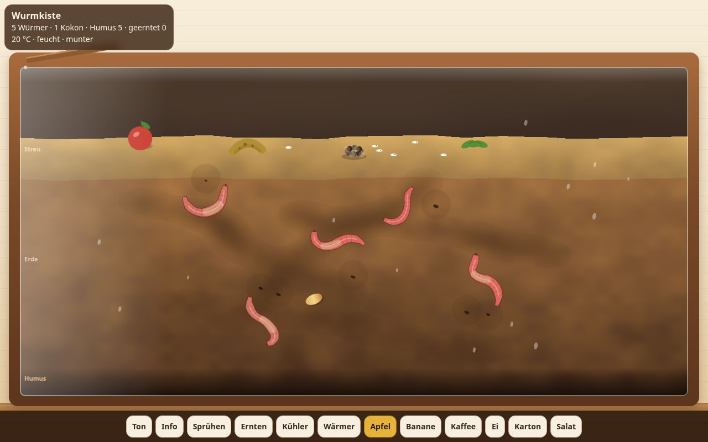

# Wurmkiste

A side-view glass worm bin on a kitchen table. Drop scraps on the soil, keep it moist, and watch the earthworms turn them into dark humus.

**Play:** open `index.html` (one file, no network, works on a phone). The page is in Swiss German (de-CH, with ss spelling).

## How to play

- Choose **Apfel**, **Banane**, **Kaffee**, **Ei**, **Karton** or **Salat**, then tap the top of the glass. The scraps brown, go soft, and grow a little mold. Springschwänze and Milben show up as they rot.
- Segmented earthworms crawl through the layers, eat, and leave dark castings. The castings settle into a humus band at the bottom.
- **Sprühen** wets the bin. **Kühler** and **Wärmer** change the temperature. Worms stay busy when it is moist and about 20 °C. Too dry, too hot, too cold, or too many apples (sour, like citrus) and they retreat downward. An eggshell calms the acid.
- When a worm is well fed and the bin is mild, it leaves a cocoon. Baby worms hatch from it.
- **Ernten** scoops out the humus once enough has gathered, and adds it to the harvest count.
- **Info**, or a tap on a worm, cocoon or critter, opens a short card. The chips inside switch topics.
- **Ton** stays off until you tap it. After that, bites make a soft crunch and spraying sounds like light rain. Nothing plays before the first tap.

The bin is saved on this device. Time away keeps working, but only up to half an hour, so a long absence cannot empty the glass or fill the bucket on its own.

Keys: M sound, I info, S spray, E harvest, 1–6 scraps, + / − temperature, Esc closes a card.

Made by Playbot.
