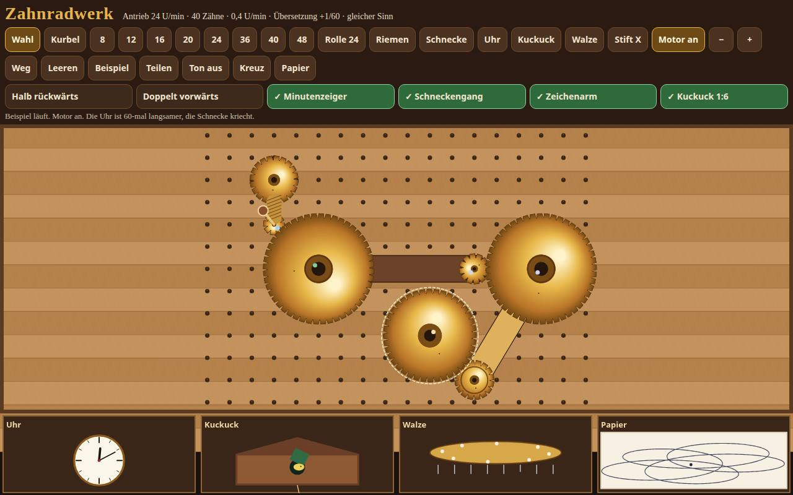

# Zahnradwerk

A brass-and-wood pegboard. Set gears of different tooth counts on the pegs, join pulleys with a belt, and add a worm. Anything that nearly touches meshes. Speed and direction spread out from the crank (the Antrieb), or from the motor. A loop that disagrees with itself — an odd cycle, or two paths that want different speeds — locks. Those wheels turn red and wobble, and the crank will not move.

The outputs are the point of building a ratio:

- **Uhr** — hour and minute hands. The minute hand is the shaft you coupled.
- **Kuckuck** — the bird comes out once per turn of its shaft.
- **Walze** — a little cylinder plucks a short row of notes.
- **Stift** — two shafts drive a pen, like a harmonograph, and it draws on the paper.

**Aufträge** on the board:

- Halb rückwärts: some wheel at −1/2 (20 teeth on the crank, meshing with 40).
- Doppelt vorwärts: some wheel at +2 (16 on the crank, an idler of 12, then 8).
- Minutenzeiger: the clock at +1/60, same direction as the crank.
- Schneckengang: the worm driving a wheel at 1:20 or slower.
- Zeichenarm: the pen following two shafts that do not share a speed.
- Kuckuck 1:6: the bird on a shaft at +1/6 or −1/6 (8 teeth into 48).

A second gear on the same peg is locked to that shaft, on another layer, so a compound is possible. **Rolle** places a pulley (tap again to change 12, 24, 40). **Riemen** joins two pulleys; **Kreuz** flips the belt so the far side runs the other way. The worm drives a gear beside it, one tooth per turn, and a gear cannot turn the worm.

Drag the crank handle, or switch **Motor** on and change the Drehzahl. The line under the title shows revolutions per minute and the Übersetzung of the peg you picked. **Ton** stays off until the first tap, then a tick, the cylinder and the cuckoo. **Beispiel** loads a movement that already does the minute hand, the worm, the pen and the cuckoo. **Leeren** clears the board (tap twice). The board is kept on this device. **Teilen** copies a link; the hash is the whole mechanism.

Labels are German as used in Switzerland: double s, and no eszett. One self-contained `index.html`, no libraries and no network. It fits a phone in portrait and landscape and a desktop, with the mouse or a finger.

