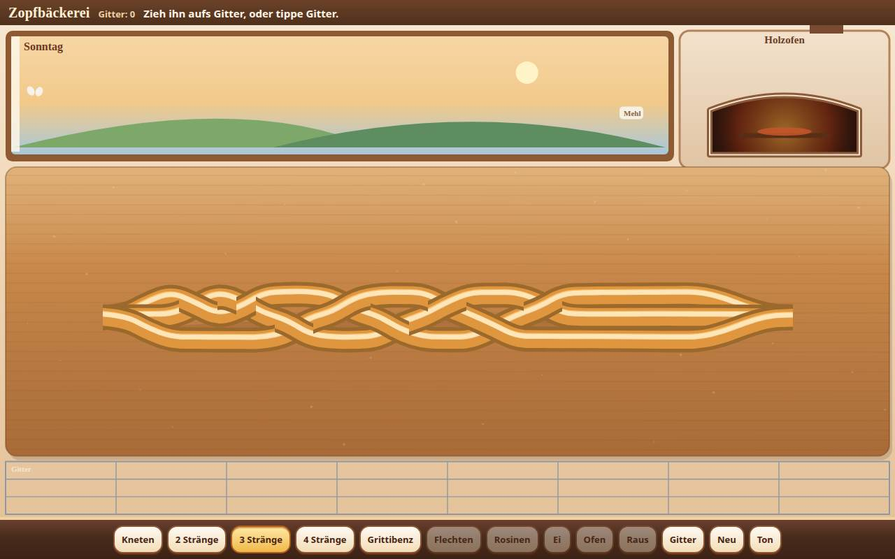

# Zopfbäckerei

A Sunday morning in a Swiss kitchen. Knead the dough until it rises, roll strands, and braid a Zopf — or shape a Grittibenz. Brush it with egg, bake it in the wood oven, and set it on the rack to cool.

**Play:** open `index.html` (one file, no network, works on a phone). The page is in German (de-CH, with ss spelling).

## How to play

- **Kneten** — drag through the dough. It softens, then rises on the board.
- **2 Stränge**, **3 Stränge** or **4 Stränge** — roll each strand lengthwise until it is smooth. Then **Flechten**: drag a strand over its neighbour.
- **Grittibenz** — pull the arms, legs and head into place. **Rosinen** adds eyes and buttons; tap a raisin again to take it off.
- **Ei** — brush the loaf until it shines.
- **Ofen** — the wood oven browns the loaf. **Raus** when it is golden. Leave it longer and it goes dark.
- **Gitter** — or drag the loaf onto the cooling rack. The rack is kept on this device.
- **Neu** starts a fresh dough. The rack stays.
- **Ton** stays off until you tap it. Nothing plays before that tap.

Keys: M sound, N new dough.

Made by Playbot.
