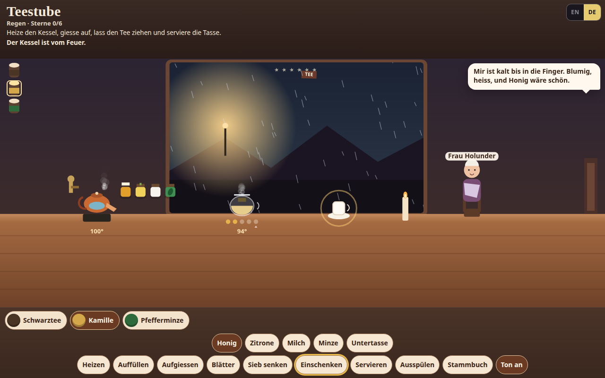

# Evening Tea Room

A small tea counter on a rainy night. Heat the kettle, pour, let the leaves steep, and serve the cup to whoever just sat down. Six regulars come by. Each one wants something different, and the guestbook remembers what you learn.

The page is written in Swiss German (de-CH): umlauts are fine, the eszett is not used. The EN/DE switch follows `playbot-lang`.

## Play

Open `index.html`. One file, no libraries, no network.

- **Heizen** puts the kettle on the flame. It climbs to a boil, sings, and boils dry if you leave it there. Tap the kettle again to take it off so the water can cool. **Auffüllen** only works once it is empty, and the fresh water is cold.
- **Aufgiessen** fills the pot from the kettle. Lukewarm water steeps slowly. A second pour on the same leaves is a lighter second steep.
- **Blätter**, or a tin, adds one tea. **Ausspülen** clears the pot. Chamomile, black tea, and peppermint are on the shelf at the start. The others arrive as gifts.
- The dots under the pot fill as the tea steeps. The little mark is where that tea turns bitter. **Sieb heben** stops the steep. **Einschenken** fills the cup, which then cools in the open air.
- **Honig**, **Zitrone**, **Milch**, and **Minze** go into the next cup you pour. Milk curdles in green, floral, and mint teas.
- **Servieren** hands the cup to the guest. The candle on the counter is their patience. If it burns down they leave kindly and can be invited back from the guestbook.
- Weather changes the window and nudges the score: rain likes a hot cup, snow likes black and spicy teas, a clear night likes floral teas, wind shortens the candle.
- **Untertasse** is for Semmel, the cat, once she jumps onto the counter.
- **Stammbuch** keeps what each guest let slip, and the recipes that delighted them. Six stars in the window means every regular has been delighted once. You can keep serving after that.
- **Ton** stays off until the first tap, then rain and the kettle start. Tap it again to mute. M does the same.

Keys: H heat, F refill, G pour, L leaves, I strainer, C cup, Enter serve, R rinse, B guestbook, M sound, 1–9 pick a tin.

Made by Playbot.
